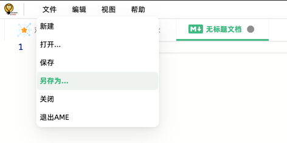
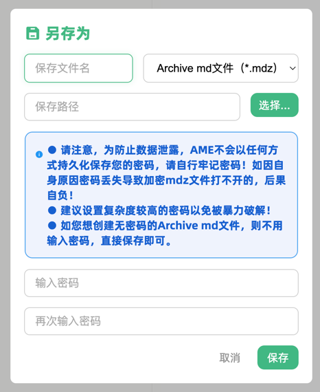
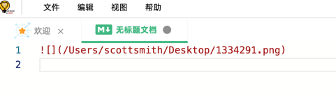
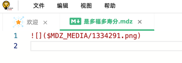
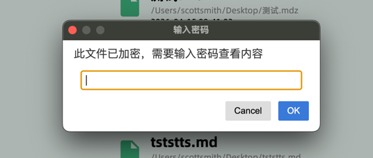
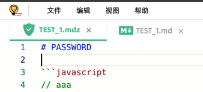
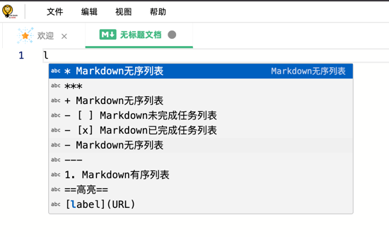

# Archive Markdown Editor User Guide

## I. Installation

1. Method 1: You can download the installation package corresponding to your system from GitHub Release or the official website and install it.
2. Method 2: Git clone this repo, then run `npm install`, and last run `node ./utils/compile.mjs`.

> The `node ./utils/compile.mjs` installation method just cover macOS arm64 and Linux x64.
> 
> If you are using another OS, please refer to utils/compile.mjs to compile it yourself.

If you encounter the following error during compilation on the Windows platform:

```text
C:\path\to\bit7z\src\internal\xxx.cpp(1,1): warning C4819: This file contains characters that cannot be represented in the current code page (936). Please save this file in Unicode format to prevent data loss.
```

Open the xxx.cpp file in the bit7z project using Visual Studio, navigate to the menu bar `File` > `Advanced Save Options`, set the file encoding to `Unicode (UTF-8 with signature) - code page 65001` and save.

Then continue compiling, and there will be no more errors.

## II. Special features and AME-specific syntax

> CAUTION: If you need to write Markdown across different software, please <u>do not save as an mdz file</u> and <u>do not use AME-specific syntax</u>. Saving the mdz file as an md file will solve most of the problems that occur when writing Markdown across different software.

#### 1. The new file format "mdz"

> The essence of inserting multimedia in traditional Markdown is to insert **the location information of the specified multimedia** (including online URLs/offline file paths). Markdown is **not strongly bound to multimedia files**, which easily leads to the problem of **multimedia loss**, affecting the readability of Markdown articles. Moreover, scattered multimedia files and Markdown files mixed together are inconvenient for archiving and management.
>
> This format can effectively **EMBED MULTIMEDIA FILES such as images, videos, and audio** in Markdown (including common file types such as PDF, docx, pptx, xlsx, and compressed files).
>
> This file format is essentially a 7-Zip compressed archive, with the extension changed from *.7z to *.mdz. The name comes from Markdown + 7z. This format can organically combine multimedia files and Markdown, packaging them together. When sharing Markdown files containing multimedia with others, only one file needs to be shared, eliminating the need to worry about separate multimedia files.
>
> Because Microsoft Office's \*.docx files are too cumbersome and inflexible, and difficult to embed video and audio, we urgently needed a format that combines the lightweight, flexible, and user-friendly nature of Markdown with the strong multimedia archiving capabilities. Therefore, \*.mdz was born!

mdz structure:

```text
Using "file_name.mdz" as an example filename

file_name.mdz
    └── mdz_contents/
        ├── content.md
        └── media_src/
                 └── media.jpg
                 └── media.mp4
                 └── media.wav
                 └── media.zip
                 └── ...
```

The folders `mdz_contents` and `media_src` have fixed names.

The Markdown file inside `mdz_contents` always has the fixed name `content.md`, no matter what the `.mdz` file itself is called.

The names of the media files inside the `media_src` folder do not need to be fixed.

> Because nothing inside the archive depends on the `.mdz` file name, you can freely rename a `.mdz` file (for example in your file manager) and it will still open correctly.
>
> Older `.mdz` files, whose inner Markdown file was named after the `.mdz` file, are still supported: Archive Markdown Editor opens that file as-is, and rewrites it as `content.md` the next time you save.

When opening an `.mdz` file, Archive Markdown Editor extracts it into a hidden folder named `._mdz_content.<mdz file name>` next to the `.mdz` file; this folder is removed again once the document tab is closed. Since that folder name is derived from the **current** file name, renaming a `.mdz` file does not break its internal media links either.

> ATTENTION: Archive Markdown Editor reads mdz files by decompressing them, so it will occupy 2 times or more of the storage space.

Saving as an MDZ file is very easy. Just click "Save As".



In the Save As dialog box, select "Archive MD file (*.mdz)" from the file format drop-down menu.



Additionally, when you save as an .mdz file, any imported multimedia files (via your local absolute path)



will be automatically embedded in the .mdz file and converted to .mdz media paths. Therefore, you don't need to worry about multimedia management; AME will handle it all for you!



When you save, you'll find a password input box at the bottom. That's right, you can set a password for your .mdz file to protect its content! This will be explained in detail below.


#### 2. Set a password for "mdz"

> [!tip]
>
> Since traditional Markdown files are essentially text files, their contents can be easily viewed, offering no privacy or security whatsoever.

Go back to the "Save As" dialog box, where there is a password input box at the bottom. When you specify a password when saving the .mdz file, the final saved file will be a password-protected .mdz file.

When a password is given, the package is encrypted with the 7z format's default AES-256 cipher, and AME additionally turns on 7z header encryption: without the password you cannot read not only the Markdown text and the multimedia data inside the package, but also the entry names and the directory structure (third-party archiving tools need the password to see anything either).

Of course, if you don't fill in the password box below when saving the .mdz file, the final saved file will be an unencrypted .mdz file without a password.


When Archive Markdown Editor opens an encrypted .mdz file, a password input box will immediately pop up for you to enter a password. If you enter an incorrect password, the file will not open; instead, the window will repeatedly pop up for you to re-enter the password. The input box will only disappear if you click "Cancel" manually.



When you successfully open an encrypted .mdz file, you will find that the corresponding label icon is a security shield. This is a unique identifier for encrypted .mdz files, and it is different from the label icons for ordinary Markdown files and unencrypted .mdz files.



> [!caution]
>
> CAUTION: To prevent data leakage, Archive Markdown Editor **DOES NOT persistently store your password in any way**. Please remember your password! If you lose your password due to your own reasons and cannot open the encrypted .mdz file, you will be **at your own risk**!
>
> We recommend setting a strong password to prevent brute-force attacks!

#### 3. It can embed more than just images.

mdz files support embedding images, videos, audio, and other downloadable files, utilizing the unique syntax of Archive Markdown Editor.

When you want to insert a video, AME's specific syntax is as follows:

```AME-specific-syntax

```

If your multimedia filename contains spaces (such as "media space.mp4"), you can replace the spaces with "%20":

```AME-specific-syntax

```

In this section, the caption, which was originally a Markdown image statement, has been further subdivided to support multimedia: `${video}:` can contain any content. The `${video}:` part is a fixed-structure multimedia format identifier (note the colon).

When you want to insert audio, AME's specific syntax is as follows:

```AME-specific-syntax

```

Of course, some might also say that Archive Markdown Editor also supports sharing an interesting file along with the .mdz file. AME's unique syntax is as follows:

```AME-specific-syntax

```

Click to save to any location (if you can).

Of course, if you find the audio or video content interesting, you can change its identifier to "file" to download it!

```AME-specific-syntax


```

#### 4. Intelligent suggestions make writing easier

Archive Markdown Editor features excellent Markdown intelligent suggestions. When you type specific keywords in the editor while editing a document, Archive Markdown Editor will automatically match and display the Markdown statements you want to enter based on those keywords; you simply need to select them.

For intelligent keyword suggestions, please refer to `Menu bar > Help > Markdown Learning...`.



#### 5. Exporting: HTML and PDF

The menu bar `File > Export...` exports the body of the current tab as **HTML** or **PDF**.

##### Export as HTML

Pick a save location and you are done. The result is `name.html`; whenever the document references local media, AME also creates a `name.media_dir` folder next to it, holding the copied images/videos/audio/downloadable files plus the offline assets of Mermaid, Prism and MathJax (including every tex extension and math font).

That makes the exported HTML **fully usable offline**: code highlighting, diagrams and formulas still work with the network unplugged. Remote image URLs and base64 images are kept as they are.

##### Export as PDF

Clicking "Export As PDF" opens an options dialog first, then asks for the save location:

| Option | Description |
|:---|:---|
| Paper | A3 / A4 / A5 / A6 / Letter / Legal / Tabloid |
| Orientation | Portrait / Landscape |
| Margins | None / Narrow / Standard / Wide. Enabling the footer reserves the minimum bottom margin the footer needs |
| Pages | Only `1-5, 8, 11-13` style ranges are accepted; leave it blank for all pages |
| Print background colors and images | On by default; switch it off and the theme's background/alert colours are not printed |
| Show date, title and page number in footer | Footer reads "date title current page / total pages" |
| Generate PDF outline bookmarks | Built from the document headings (a Chromium experimental feature, some readers hide it) |

The PDF is typeset with the **viewer theme** you selected in Settings, the very same source used by the in-app preview and the exported HTML.

Two differences from exporting HTML:

1. **PDF never creates a `.media_dir` folder.** A PDF is a one-off artefact: local images and mdz embedded images are read from their original absolute paths while laying out and then embedded into the PDF, so the only file produced is the `.pdf`.
2. **Audio and video become static cards in the PDF** (an icon + the file name + the caption). A PDF is a static document and printed player controls cannot be operated, so they are represented honestly as cards.

> [!note]
>
> The body sent to the PDF exporter goes through the same HTML sanitizing rules as the in-app preview, so `<script>`, `<iframe>` and friends are stripped before exporting. PDF export is not offered on HarmonyOS.

#### 6. Built-in Tools: LaTeX Editor and Mermaid Editor

Menu `Tools > LaTeX Editor...` and `Tools > Mermaid Editor...` each open a "write on the left, see on the right" tool in **its own tab**.

| Area | Content |
|:---|:---|
| Left half | Monaco Editor, the very same one used by the file editor, so font size, line numbers, theme and word wrap follow your editor settings |
| Right half | Live preview. LaTeX is typeset by MathJax, Mermaid is rendered as a diagram. It refreshes about 0.3 s after you stop typing |
| Copy Code | Put the whole left-hand source onto the clipboard so you can paste it straight into your document |
| Clear | Empty the left-hand editor. `Ctrl` `Z` still brings it back |

IntelliSense is the main point of these two tools:

- **LaTeX**: typing a backslash `\` triggers completion, covering Greek letters, operators and relations, arrows, delimiters, big operators, accents and spacing commands; typing `\begin` offers a ready-made environment scaffold with its matching `\end{...}`; inside `\end{` the first suggestions are the environments your document has not closed yet.
- **Mermaid**: the first line offers diagram types (over 20 — `flowchart`, `sequenceDiagram`, `classDiagram`, `stateDiagram-v2`, `erDiagram`, `gantt`, `pie`, `gitGraph`, `mindmap`, `timeline`, ...); once the type is known, suggestions switch to that type's context keywords (e.g. `participant`, `activate`, `note over`, `alt`/`else` under `sequenceDiagram`, or `dateFormat`, `section`, `crit` under `gantt`), and arrow syntax is offered from the second line on.

A few practical notes:

1. **A sample source ships with the first opening**, so the left-right feedback is immediate; once cleared it is not restored automatically.
2. **Switching tabs never loses your work.** Only one tab per tool kind can exist — clicking the menu item again just focuses it, and LaTeX and Mermaid are independent of each other.
3. **Closing the tab does not ask about unsaved changes.** These are scratch pads: nothing is written to any file, so use "Copy Code" and paste into your document if you want to keep it.
4. When Mermaid hits a syntax error, the error text is shown right in the preview and disappears as soon as you fix it.

> [!note]
>
> The preview reuses the very same offline MathJax and Mermaid assets as the in-app preview, so no network is needed. The left-hand side only ever holds source text and is never rewritten by the typesetter.

## III. Archive Markdown Editor Hotkey Table

| Operation       | Windows/Linux    | macOS         |
|:---------|:-------------------|:----------------|
| New File     | `Ctrl` `N`         | `⌘` `N`         |
| Open File     | `Ctrl` `O`         | `⌘` `O`         |
| Close Tab     | `Ctrl` `W`         | `⌘` `W`         |
| Cut/Copy/Paste | `Ctrl` `X`/`C`/`V` | `⌘` `X`/`C`/`V` |
| Undo/Redo    | `Ctrl` `Z`/`Y`     | `⌘` `Z`/`Y`     |
| Open User Guide   | `Ctrl` `Shift` `H` | `⌘` `Shift` `H` |
| Open Settings     | `Ctrl` `,`         | `⌘` `,`         |
| Exit AME    | `Ctrl` `Q`         | `⌘` `Q`         |

## IV. Set AME as the default app for md, mdz and txt on Linux

> [!note]
>
> This section is about Linux only, and describes the `.deb` package.

Once the `.deb` package is installed, AME has already registered the three types below with the system, so Archive Markdown Editor shows up in GNOME `Settings → Default Applications` and in every file manager `Open With` list:

| File | MIME type |
|:---|:---|
| `.md` | `text/markdown` |
| `.txt` | `text/plain` |
| `.mdz` | `application/prs.archive-markdown-format` (AME's own type, registered by the package) |

There are two ways to hand those files to AME:

1. Right-click a `.md`, `.mdz` or `.txt` file in the file manager → `Open With Other Application` → pick Archive Markdown Editor (GNOME Files needs `Other Options…` first) and tick `Set as default`.
2. From a terminal:

```bash
xdg-mime default archive-markdown-editor.desktop text/markdown
xdg-mime default archive-markdown-editor.desktop text/plain
xdg-mime default archive-markdown-editor.desktop application/prs.archive-markdown-format
```

Check whether it took effect:

```bash
xdg-mime query default text/markdown      # want: archive-markdown-editor.desktop
xdg-mime query filetype ./demo.mdz        # want: application/prs.archive-markdown-format
```

After that, double-clicking a file opens it in AME. If AME is already running, the file is handed to the existing window instead of spawning a second instance.

> [!caution]
>
> `mdz` is a private format of AME and is not in the system MIME database. Without registration it is detected as `application/zip` and fights with archive managers in the `Open With` list, which is why the `.deb` package ships a MIME declaration for `mdz`. Uninstalling the package removes that declaration, but the MIME cache is only refreshed by the next `update-mime-database /usr/share/mime`; the defaults you set yourself in `$HOME/.config/mimeapps.list` have to be cleaned up manually as well.

**AppImage users**: an AppImage does not register anything system-wide on its own. Either

- let an integration tool such as `appimaged` or `AppImageLauncher` import it — it reads the `.desktop` file inside the AppImage, which already carries the MIME types and the launch arguments above;
- or place a `.desktop` file in `$HOME/.local/share/applications/` yourself, point `Exec=` at the absolute path of the AppImage and **keep the trailing `--direct-open-file=%f`**, then add the `mdz` MIME declaration as follows:

```bash
mkdir -p "$HOME/.local/share/mime/packages"
cat > "$HOME/.local/share/mime/packages/archive-markdown-editor.xml" <<'EOF'
<?xml version="1.0" encoding="utf-8"?>
<mime-info xmlns="http://www.freedesktop.org/standards/shared-mime-info">
  <mime-type type="application/prs.archive-markdown-format">
    <glob pattern="*.mdz"/>
    <comment>Archive Markdown Editor archive document</comment>
    <icon name="x-office-document"/>
  </mime-type>
</mime-info>
EOF
update-mime-database "$HOME/.local/share/mime"
update-desktop-database "$HOME/.local/share/applications"
```
