# Mermaid Learning

> [!note]
>
> Every example below was verified to render on the **Mermaid 10.9.8** bundled with Archive Markdown Editor. To edit and preview side by side, open "Tools > Mermaid Editor" from the menu bar.
>
> Each section follows the same layout as "Markdown Learning": source first, then the rendered result.

---

## I. General rules

#### 1. The first line declares the diagram type

Mermaid decides which diagram you mean from the **first line**. Get it wrong and everything after it fails.

````markdown

````

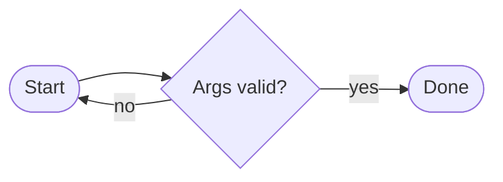

> [!caution]
>
> The declaration line must **occupy a line of its own**. In several diagram types a blank line inside the body is also treated as the end of the diagram — when you hit a mysterious error, delete the blank lines first.

#### 2. Comments use `%%`

````markdown
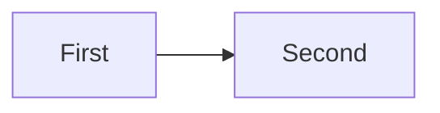
````


> [!caution]
>
> A `%%` comment **must occupy a line of its own**. Putting it at the end of a statement (`A[First] --> B[Second] %% note`) produces an immediate `Parse error`.

#### 3. One statement per line

Mermaid has no line continuations. **Write one statement per line**, and don't cram several nodes onto one line (only a few diagram types allow it).

#### 4. Nodes are "ID + shape"

The ID is the short name used by links; the text inside brackets is what gets drawn. IDs may only contain letters, digits and `_` — **put non-ASCII text inside the shape brackets**, never use it as an ID.

````markdown
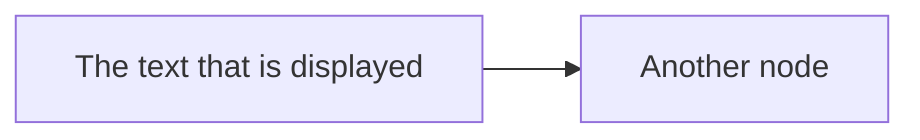
````


> [!tip]
>
> When your text contains characters that clash with the grammar — `()`, `{}`, `[]`, `<>`, `#` — wrap the text in quotes: `A["Special chars (test)"]`.

#### 5. How to write it in Markdown

Use a fenced code block tagged `mermaid` and Archive Markdown Editor turns it into a diagram automatically:

`````markdown
````markdown
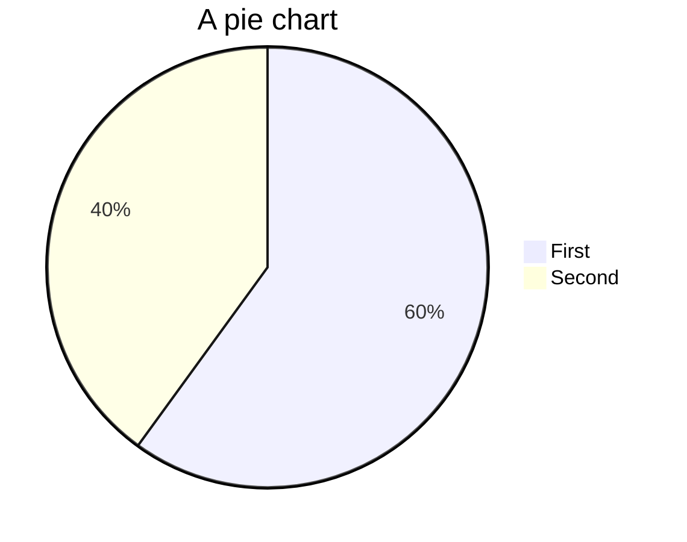
````
`````

````markdown

````

To show the diagram **source** instead of the diagram, wrap the `` ```mermaid `` block in another code block, as above.

#### 6. Use `%%{init}%%` to change theme and look

An init directive may precede the first line, and it applies to **the current diagram only**:

````markdown
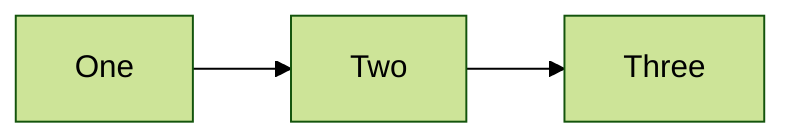
````


Common themes are `default`, `forest`, `dark` and `neutral`; `%%{init: {"themeVariables": {"primaryColor": "#ffe4c4"}}}%%` tunes colours in more detail.

---

## II. Flowcharts

Flowcharts are the most used diagrams. `graph` is the legacy keyword and `flowchart` the modern one — **prefer `flowchart`**, which supports more.

#### 7. Direction

````markdown
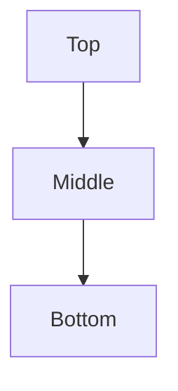
````

`TD`/`TB` top to bottom, `BT` bottom to top, `LR` left to right, `RL` right to left:


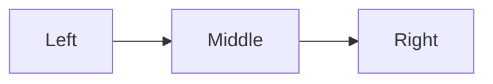

#### 8. Node shapes

````markdown

````

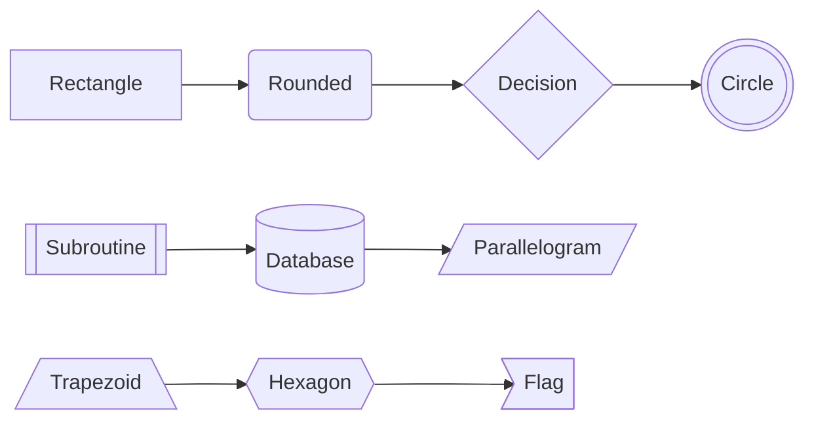

Shape cheatsheet: `[text]` rectangle, `(text)` rounded, `[[text]]` subroutine, `[(text)]` database, `((text))` circle, `(((text)))` double circle, `{text}` diamond, `{{text}}` hexagon, `[/text/]` parallelogram, `[/text\]` trapezoid, `[\text/]` inverse trapezoid, `>text]` flag.

#### 9. Link styles

````markdown
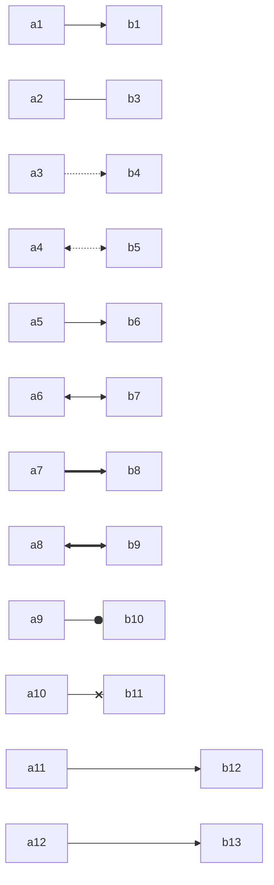
````


`---` plain line, `-->` arrow, `<-->` double arrow, `-.->` dashed arrow, `<.->` double dashed, `==>` thick line, `<==>` double thick, `--o` circle end, `--x` cross end, `x-->`/`o-->` reversed endpoints.

> [!caution]
>
> Some arrow spellings are traps. These **fail on 10.9.8**, however common they look in older tutorials: `A <-- B` (write `<-->`), `A <== B` (write `<==>`), and `A o-- B` / `A x-- B` (the endpoint marker must hug the arrow head — write `--o`, `--x`, `o-->` or `x-->`).

#### 10. Text on links

Two spellings: wrapped in pipes, or tucked into the gap of the arrow (the text must come **before** the closing arrow marker).

````markdown
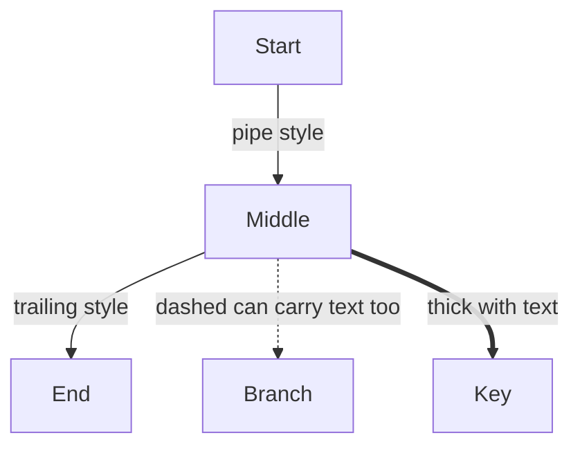
````


#### 11. One node, many links

````markdown
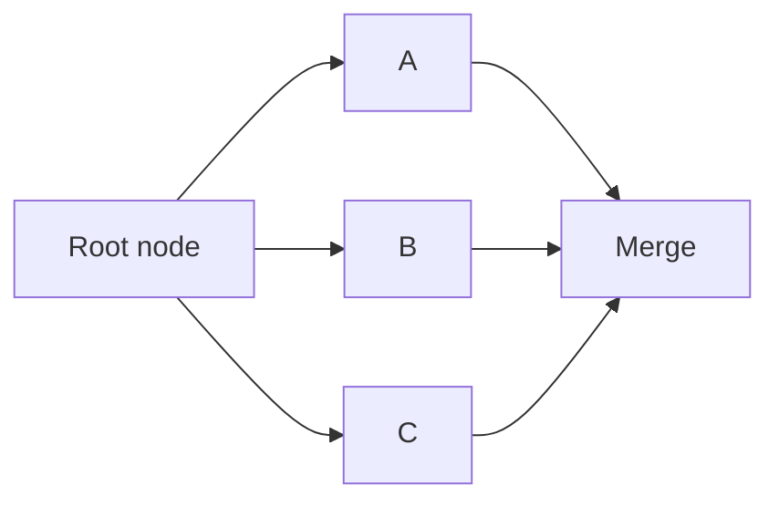
````

```mermaid
flowchart LR
root[Root node] --> a[A]
root --> b[B]
root --> c[C]
a & b & c --> merge[Merge]
```

`&` groups several nodes together and saves retyping.

#### 12. Subgraphs with `subgraph`

````markdown
```mermaid
flowchart TB
A[External input] --> ui1
subgraph Frontend
direction LR
ui1[Views] --> ui2[State management]
end
ui2 --> B[Backend]
subgraph BackendGroup
api[API layer] --> db[(Database)]
end
B --> api
```
````

```mermaid
flowchart TB
A[External input] --> ui1
subgraph Frontend
direction LR
ui1[Views] --> ui2[State management]
end
ui2 --> B[Backend]
subgraph BackendGroup
api[API layer] --> db[(Database)]
end
B --> api
```

`subgraph Name` opens and `end` closes it; inside a subgraph you can set its own `direction`. Subgraphs can also be linked themselves, using the `subgraph id [Title]` form.

#### 13. Colours and styling

Three tools: `style` for a single item, `classDef` + `class` for batches, `linkStyle` for links.

````markdown
```mermaid
flowchart LR
A[Plain] --> B[Warning]
B --> C[Focus]
A --> D[Passed]
classDef danger fill:#fee,stroke:#b91c1c,stroke-width:2px,color:#7f1d1d
classDef focus fill:#eff6ff,stroke:#1d4ed8,color:#1e3a8a
classDef pass fill:#f0fdf4,stroke:#15803d,color:#14532d
class B danger
class C focus
class D pass
style A fill:#fef3c7,stroke:#b45309
linkStyle 0 stroke:#b91c1c,stroke-width:3px
```
````

```mermaid
flowchart LR
A[Plain] --> B[Warning]
B --> C[Focus]
A --> D[Passed]
classDef danger fill:#fee,stroke:#b91c1c,stroke-width:2px,color:#7f1d1d
classDef focus fill:#eff6ff,stroke:#1d4ed8,color:#1e3a8a
classDef pass fill:#f0fdf4,stroke:#15803d,color:#14532d
class B danger
class C focus
class D pass
style A fill:#fef3c7,stroke:#b45309
linkStyle 0 stroke:#b91c1c,stroke-width:3px
```

> [!note]
>
> The number after `linkStyle` is the **index of the link**, counted from 0 in the order links appear in the source; `all` targets every link. There is also a shorthand: `B[Warning]:::danger`.

---

## III. Sequence diagrams

#### 14. Participants and messages

````markdown
```mermaid
sequenceDiagram
participant U as User
participant W as Web page
participant S as Server
U->>W: click login
W->>S: submit credentials
S-->>W: return token
W-->>U: show home
```
````

```mermaid
sequenceDiagram
participant U as User
participant W as Web page
participant S as Server
U->>W: click login
W->>S: submit credentials
S-->>W: return token
W-->>U: show home
```

`participant ID as Display name` declares a participant with an alias; participants are laid out left to right in declaration order.

#### 15. The four arrows

| Spelling | Meaning | Rendering |
|:---|:---|:---|
| `A->>B` | synchronous call with solid arrowhead | the everyday choice |
| `A-->>B` | dashed return | used for responses |
| `A->B` | thin line, solid arrowhead | no special meaning |
| `A-->B` | thin dashed line | no special meaning |

#### 16. Activations

````markdown
```mermaid
sequenceDiagram
participant C as Client
participant S as Service
C->>S: request data
activate S
S-->>C: response
deactivate S
C->>+S: shorthand: request and activate
S-->>-C: shorthand: respond and deactivate
```
````

```mermaid
sequenceDiagram
participant C as Client
participant S as Service
C->>S: request data
activate S
S-->>C: response
deactivate S
C->>+S: shorthand: request and activate
S-->>-C: shorthand: respond and deactivate
```

`activate`/`deactivate` draw the vertical bars that make lifetimes readable; you can also write `+`/`-` directly on the arrow.

#### 17. Notes

````markdown
```mermaid
sequenceDiagram
participant A as Alice
participant B as Bob
Note over A,B: a note spanning both participants
Note left of A: a note on the left
Note right of B: a note on the right
```
````

```mermaid
sequenceDiagram
participant A as Alice
participant B as Bob
Note over A,B: a note spanning both participants
Note left of A: a note on the left
Note right of B: a note on the right
```

#### 18. Loops and branches

````markdown
```mermaid
sequenceDiagram
participant U as User
participant S as Service
loop every 30 seconds
U->>S: ping
S-->>U: pong
end
alt token valid
S-->>U: return data
else token expired
S-->>U: 401 unauthorized
U->>S: refresh token
else service failure
S-->>U: 500
end
opt debugging enabled
S-->>U: debug log
end
par concurrent requests
S->>U: push message A
and
S->>U: push message B
end
```
````

```mermaid
sequenceDiagram
participant U as User
participant S as Service
loop every 30 seconds
U->>S: ping
S-->>U: pong
end
alt token valid
S-->>U: return data
else token expired
S-->>U: 401 unauthorized
U->>S: refresh token
else service failure
S-->>U: 500
end
opt debugging enabled
S-->>U: debug log
end
par concurrent requests
S->>U: push message A
and
S->>U: push message B
end
```

`loop condition`, `alt`/`else`, `opt` and `par`/`and` are all closed with `end`. There is also `critical text` with `option` for critical regions, and `break condition` for interruption.

#### 19. Automatic numbering

Add a line with `autonumber` right after `sequenceDiagram` and messages are numbered for you:

```mermaid
sequenceDiagram
autonumber
participant A as Browser
participant B as Gateway
A->>B: open connection
B-->>A: handshake done
```

---

## IV. Other common diagrams

#### 20. Class diagrams (classDiagram)

````markdown
```mermaid
classDiagram
class Animal {
+String name
+int age
+makeSound() void
}
class Dog {
+bark() void
+fetch() void
}
class Bone {
+size int
}
Animal <|-- Dog
Dog --> "1..*" Bone : likes
Dog o-- "1" Leash : has
class Dog {
<<trainable>>
}
```
````

```mermaid
classDiagram
class Animal {
+String name
+int age
+makeSound() void
}
class Dog {
+bark() void
+fetch() void
}
class Bone {
+size int
}
Animal <|-- Dog
Dog --> "1..*" Bone : likes
Dog o-- "1" Leash : has
class Dog {
<<trainable>>
}
```

Relation symbols: `<|--` inheritance, `*--` composition, `o--` aggregation, `-->` association, `..>` dependency, `..|>` realisation. Member visibility: `+` public, `-` private, `#` protected, `~` package. A `<<stereotype>>` on the first line of the class body sets the stereotype.

#### 21. State diagrams (stateDiagram-v2)

````markdown
```mermaid
stateDiagram-v2
[*] --> Draft
Draft --> UnderReview : submit
UnderReview --> Approved : review passes
UnderReview --> Rejected : incomplete
Approved --> [*]
Rejected --> Draft : resubmit
state UnderReview {
[*] --> FormCheck
FormCheck --> DeepCheck
DeepCheck --> SignOff
}
```
````

```mermaid
stateDiagram-v2
[*] --> Draft
Draft --> UnderReview : submit
UnderReview --> Approved : review passes
UnderReview --> Rejected : incomplete
Approved --> [*]
Rejected --> Draft : resubmit
state UnderReview {
[*] --> FormCheck
FormCheck --> DeepCheck
DeepCheck --> SignOff
}
```

`[*]` is the start/end state and `state Name { ... }` expresses composite states. There is also `state if_name <<choice>>` for decision points, `<<fork>>`/`<<join>>` for concurrent split and merge, and `state Name : caption` to add a subtitle.

#### 22. ER diagrams (erDiagram)

````markdown
```mermaid
erDiagram
USER ||--o{ ORDER : "places"
ORDER ||--|{ ORDER_ITEM : "contains"
PRODUCT ||--o{ ORDER_ITEM : "purchased by"
USER {
string id "user id"
string nickname "nickname"
string email "e-mail"
}
ORDER {
string id "order no"
datetime created_at "created at"
int total "total items"
}
ORDER_ITEM {
string id "line no"
int quantity "quantity"
decimal price "unit price"
}
```
````

```mermaid
erDiagram
USER ||--o{ ORDER : "places"
ORDER ||--|{ ORDER_ITEM : "contains"
PRODUCT ||--o{ ORDER_ITEM : "purchased by"
USER {
string id "user id"
string nickname "nickname"
string email "e-mail"
}
ORDER {
string id "order no"
datetime created_at "created at"
int total "total items"
}
ORDER_ITEM {
string id "line no"
int quantity "quantity"
decimal price "unit price"
}
```

> [!caution]
>
> ER diagrams are the strictest about text: **entity names, attribute types and attribute names must be ASCII letters, digits and underscores**. `Customer ||--o{ Order` with a non-ASCII name fails outright. Free text may only appear in two places — the relation label (must be quoted, e.g. `: "places"`) and the comment after an attribute (also quoted, e.g. `string id "user id"`).
>
> Prefer all-upper-case entity names (`USER`, `ORDER_ITEM`); lower case can trigger `Expecting 'ALPHANUM'...` in some forms.
>
> Reading the cardinality: `||` exactly one, `|o` zero or one, `}o` zero or more, `|{` one or more. The left half describes the left entity and the right half the right one, so `USER ||--o{ ORDER` means "one user has zero or more orders".

#### 23. Gantt charts (gantt)

````markdown
```mermaid
gantt
title Project schedule
dateFormat YYYY-MM-DD
section Design
Requirements review :done, d1, 2025-01-06, 3d
Prototyping :active, d2, after d1, 5d
section Engineering
Frontend work :d3, after d2, 10d
Backend work :d4, after d2, 12d
Integration tests :crit, d5, after d4, 5d
```
````

```mermaid
gantt
title Project schedule
dateFormat YYYY-MM-DD
section Design
Requirements review :done, d1, 2025-01-06, 3d
Prototyping :active, d2, after d1, 5d
section Engineering
Frontend work :d3, after d2, 10d
Backend work :d4, after d2, 12d
Integration tests :crit, d5, after d4, 5d
```

A task line is `name :status, ID, start, duration`. Status markers are `done`, `active` and `crit`; the start can be a literal date or `after someTaskId` to chain automatically. `todayMarker off` hides the vertical "today" line.

#### 24. Pie charts (pie)

````markdown
```mermaid
pie showData
title Browser market share
"Chrome" : 65.2
"Safari" : 18.8
"Edge" : 5.3
"Others" : 10.7
```
````

```mermaid
pie showData
title Browser market share
"Chrome" : 65.2
"Safari" : 18.8
"Edge" : 5.3
"Others" : 10.7
```

`showData` prints the values on the slices too. The numbers do not need to add up to 100.

#### 25. Timelines (timeline)

````markdown
```mermaid
timeline
title Archive Markdown Editor milestones
2024 : project started : mdz format defined
2025 : first stable release : embedded media
2026 : tooling : LaTeX Editor and Mermaid Editor
```
````

```mermaid
timeline
title Archive Markdown Editor milestones
2024 : project started : mdz format defined
2025 : first stable release : embedded media
2026 : tooling : LaTeX Editor and Mermaid Editor
```

`time : eventA : eventB` lays several events at the same point side by side, and indentation expresses nesting.

#### 26. User journeys (journey)

````markdown
```mermaid
journey
title One-click ordering
section Browsing
Open the app: 5: Customer
Search products: 4: Customer
section Ordering
Add to cart: 3: Customer
Submit order: 2: Customer, System
Pay: 1: Customer, System
```
````

```mermaid
journey
title One-click ordering
section Browsing
Open the app: 5: Customer
Search products: 4: Customer
section Ordering
Add to cart: 3: Customer
Submit order: 2: Customer, System
Pay: 1: Customer, System
```

> [!note]
>
> The declaration keyword is `journey`, not `userJourney` (the latter is Mermaid's internal module name; writing it in a diagram yields `No diagram type detected`).
>
> A task line is `task: score: actors`, where the score runs from 1 (terrible) to 5 (great) and multiple actors are comma-separated.

#### 27. Mindmaps (mindmap)

````markdown
```mermaid
mindmap
  root((Project plan))
    Engineering
      Frontend
        UI
        Interaction
      Backend
        API
        Storage
    Marketing
      Research
        Campaigns
```
````

```mermaid
mindmap
  root((Project plan))
    Engineering
      Frontend
        UI
        Interaction
      Backend
        API
        Storage
    Marketing
      Research
        Campaigns
```

> [!caution]
>
> mindmap **expresses nesting purely through indentation**: the exact width does not matter, but every node on the same level must be indented identically, and spaces only (a stray Tab causes an error). The centre node is `root((text))`; node shapes also come in `()`, `[]`, `{}` and `([])` variants.

#### 28. Quadrant charts (quadrantChart)

````markdown
```mermaid
quadrantChart
title "Feature priority"
x-axis "Low effort" --> "High effort"
y-axis "Low value" --> "High value"
quadrant-1 "Invest now"
quadrant-2 "Do first"
quadrant-3 "Nice to have"
quadrant-4 "Defer"
"LaTeX Editor": [0.35, 0.8]
"Mermaid Editor": [0.5, 0.75]
"PDF export": [0.7, 0.6]
"Theme editor": [0.25, 0.2]
```
````

```mermaid
quadrantChart
title "Feature priority"
x-axis "Low effort" --> "High effort"
y-axis "Low value" --> "High value"
quadrant-1 "Invest now"
quadrant-2 "Do first"
quadrant-3 "Nice to have"
quadrant-4 "Defer"
"LaTeX Editor": [0.35, 0.8]
"Mermaid Editor": [0.5, 0.75]
"PDF export": [0.7, 0.6]
"Theme editor": [0.25, 0.2]
```

Coordinates are `[x, y]` in the range 0 to 1, and the four quadrants are numbered 1 to 4 counter-clockwise from the top right.

> [!caution]
>
> quadrantChart has the **strictest lexer** of them all: any label containing a space must be quoted in full — axis labels, quadrant names and data point names alike. A missing quote gives `Lexical error ... Unrecognized text`.

#### 29. Requirement diagrams (requirementDiagram)

````markdown
```mermaid
requirementDiagram

    requirement REQ_MDZ {
        id: "REQ-001"
        text: "Support the mdz archive format"
        risk: high
        verifymethod: test
    }

    functionalRequirement REQ_EXPORT {
        id: "REQ-002"
        text: "Export offline HTML"
        risk: medium
        verifymethod: analysis
    }

    performanceRequirement REQ_SPEED {
        id: "REQ-003"
        text: "Render a thousand-line document smoothly"
        risk: low
        verifymethod: demonstration
    }

    REQ_MDZ - contains -> REQ_EXPORT
    REQ_EXPORT - satisfies -> REQ_SPEED
```
````

```mermaid
requirementDiagram

    requirement REQ_MDZ {
        id: "REQ-001"
        text: "Support the mdz archive format"
        risk: high
        verifymethod: test
    }

    functionalRequirement REQ_EXPORT {
        id: "REQ-002"
        text: "Export offline HTML"
        risk: medium
        verifymethod: analysis
    }

    performanceRequirement REQ_SPEED {
        id: "REQ-003"
        text: "Render a thousand-line document smoothly"
        risk: low
        verifymethod: demonstration
    }

    REQ_MDZ - contains -> REQ_EXPORT
    REQ_EXPORT - satisfies -> REQ_SPEED
```

> [!caution]
>
> This diagram type is unforgiving; all four rules must hold at once:
>
> 1. the attributes inside a block **must be indented** (a flush-left `id:` errors out);
> 2. the `text:` value **must be quoted**;
> 3. relations are written `A - relation -> B` — **not** `A <- relation -> B` and not `A -[relation]-> B`;
> 4. `risk` accepts only `low`/`medium`/`high`, and `verifymethod` only `analysis`/`inspection`/`demonstration`/`test` — `performance` is not a valid value.
>
> Usable requirement types: `requirement`, `functionalRequirement`, `performanceRequirement`, `interfaceRequirement`, `physicalRequirement`, `designConstraint`. Usable relations: `contains`, `derived`, `satisfies`, `verify`, `copies`.

#### 30. Git graphs (gitGraph)

````markdown
```mermaid
gitGraph
commit
commit
branch develop
checkout develop
commit
commit
checkout main
merge develop
commit tag: "v1.0"
branch hotfix
checkout hotfix
commit
checkout main
merge hotfix
```
````

```mermaid
gitGraph
commit
commit
branch develop
checkout develop
commit
commit
checkout main
merge develop
commit tag: "v1.0"
branch hotfix
checkout hotfix
commit
checkout main
merge hotfix
```

`commit`, `branch name`, `checkout name`, `merge name`, `cherry-pick id: "..."`, `reset id: "..."`. The default branch is `main`; change it with `gitGraph: mainBranchName: "master"` in an init directive.

#### 31. XY charts (xychart-beta)

````markdown
```mermaid
xychart-beta
    title "Monthly active users"
    x-axis ["Jan", "Feb", "Mar", "Apr", "May"]
    y-axis "Active users (thousands)" 0 --> 100
    bar [24, 45, 62, 58, 91]
    line [24, 45, 62, 58, 91]
```
````

```mermaid
xychart-beta
    title "Monthly active users"
    x-axis ["Jan", "Feb", "Mar", "Apr", "May"]
    y-axis "Active users (thousands)" 0 --> 100
    bar [24, 45, 62, 58, 91]
    line [24, 45, 62, 58, 91]
```

> [!caution]
>
> The `title` and **every entry** of `x-axis` **must be double-quoted**: `x-axis [Jan, Feb]` raises `Lexical error`, while `x-axis ["Jan", "Feb"]` passes.
>
> `bar` and `line` may each appear once, or be layered. The `-beta` suffix means experimental, so this may change between versions.

#### 32. Sankey diagrams (sankey-beta)

````markdown
```mermaid
sankey-beta
Entrance,Home,120
Entrance,Search,80
Home,Detail,70
Search,Detail,50
Detail,Order,45
Detail,Churn,75
```
````

```mermaid
sankey-beta
Entrance,Home,120
Entrance,Search,80
Home,Detail,70
Search,Detail,50
Detail,Order,45
Detail,Churn,75
```

Each line is `source,target,value`; you may also start with a `source,target,value` header row.

> [!caution]
>
> Sankey node names **must be ASCII** — `Homepage,Product detail,120` with accented or non-ASCII words fails with `Parse error`, and quotes do not help either. If you need richer labels, use a flowchart instead.
>
> Also a `-beta` experimental feature.

#### 33. Block diagrams (block-beta)

````markdown
```mermaid
block-beta
columns 3
in["Input"] proc["Parse"] out["Output"]
db[("Storage")] space cache["Cache"]
in --> proc
proc --> out
proc --> db
db --> cache
cache --> out
```
````

```mermaid
block-beta
columns 3
in["Input"] proc["Parse"] out["Output"]
db[("Storage")] space cache["Cache"]
in --> proc
proc --> out
proc --> db
db --> cache
cache --> out
```

`columns N` sets how many blocks sit on a row, `space` is a blank cell, and `blockArrowShape: true` (which must go in a `%%{init}%%` directive) replaces the default connectors with arrows.

---

## V. Limits inside Archive Markdown Editor

#### 34. The security level is strict

Archive Markdown Editor runs Mermaid with `securityLevel: 'strict'`, a necessary setting so that a document cannot execute scripts through a diagram. The price:

> [!caution]
>
> - **HTML tags in node text do nothing**: `A["<b>bold</b>"]` shows the tags literally instead of bolding anything.
> - `click A "https://..."` (attaching a link to a node) and `click A callback()` (attaching a handler) are **disabled**.
> - To emphasise something, use the `style`/`classDef`/`linkStyle` syntax from section 13 rather than HTML tags.

#### 35. Only code blocks, never inline

Mermaid is supported **only as a fenced code block** (`` ```mermaid ``). There is no inline diagram. Several diagrams means several code blocks, one per diagram.

#### 36. Diagram support follows 10.9.8

Most Mermaid tutorials online target 11.x or newer, and **diagram types introduced later simply will not draw here**.

| Available here (10.9.8) | Newer than this build, **not available** |
|:---|:---|
| flowchart/graph, sequenceDiagram, classDiagram, stateDiagram-v2, erDiagram, gantt, pie, journey, requirementDiagram, gitGraph, mindmap, timeline, quadrantChart, xychart-beta, block-beta, sankey-beta, the C4 family | architecture-beta, packet-beta, radar, ishikawa, kanban, treeView, venn |

> [!tip]
>
> The most reliable way to check whether a diagram type works here: write only the declaration line in "Tools > Mermaid Editor". If a diagram appears it is supported; `No diagram type detected matching given configuration` means it is not.

#### 37. Common errors

| Symptom | Cause | Fix |
|:---|:---|:---|
| `Syntax error in text` | The declaration line is misspelled, or the block was rewritten by an earlier pass | Check the declaration spelling; reload the editor tab if needed |
| `Parse error...Expecting 'ALPHANUM'` | An ER entity or attribute name is not ASCII | Use ASCII identifiers in ER diagrams, quote the free text |
| mindmap levels scrambled, or an outright error | Inconsistent indentation, or Tabs mixed with spaces | Use spaces and align every node on the same level |
| Node text shows only half of itself | The text contains `()[]{}` grammar characters | Quote it: `A["text (with parens)"]` |
| Text rendered as an ID | Non-ASCII text used as the node ID | Keep IDs short ASCII; put display text in the shape |
| Diagram completely blank | The declaration line has extra content, or the block got nested in another block | Keep the declaration alone on its line, flush left |
| Some links vanished | A link references an undefined or misspelled node ID | Check ID spelling and case |
| `<br>` in a label does not break the line | strict security disables HTML labels | Split into two nodes, or shorten the text |
| Diagram ugly, labels crushed together | Too many nodes in one diagram | Split into several diagrams, or group with `subgraph` |

#### 38. Debugging advice

> [!tip]
>
> 1. **Cut it down until it draws.** Start with just the declaration line and two nodes, then add one line at a time; the one that breaks it is the culprit.
> 2. **Lean on "Tools > Mermaid Editor".** The right pane re-renders the moment you edit the left, which beats toggling preview in a document, and parse failures surface an error message in the preview area.
> 3. **Line numbers in errors are useful.** Mermaid's `Parse error` tells you what token it expected and on which line — go straight there.
> 4. **Not sure a diagram type is supported?** Draw the smallest possible case: declaration line plus one relation. If it renders, the type name is right.

---

## VI. Further reading

- [Official Mermaid documentation](https://mermaid.js.org/) — switch to the 10.9 docs that match this build, and do not copy 11.x syntax blindly
- [Official Mermaid live editor](https://mermaid.live/) — get it working in the browser first, then paste it back into your document
- The other two built-in documents: "Help > Markdown Learning" and "Help > LaTeX Learning"
