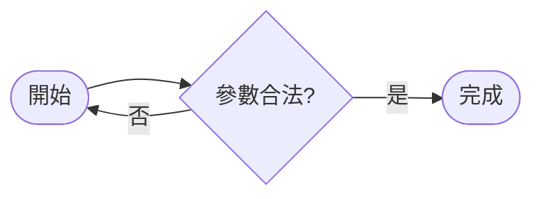
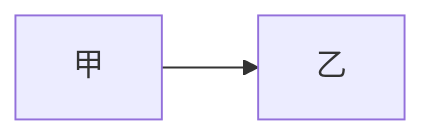
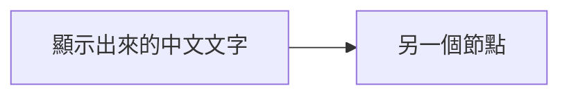
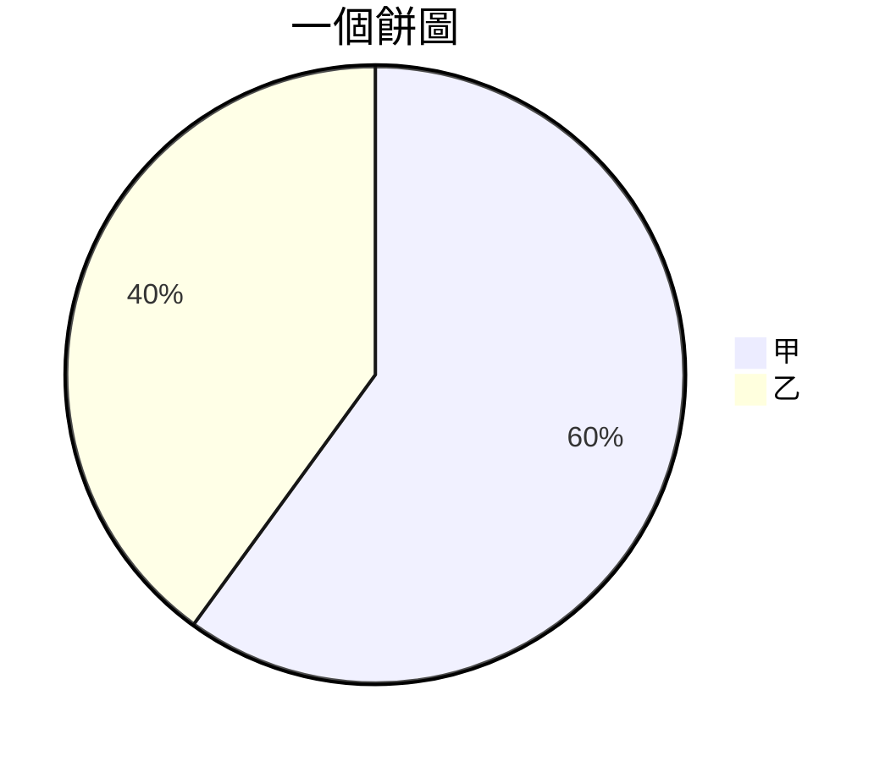
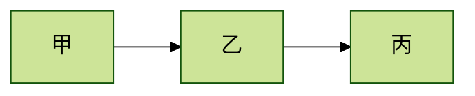
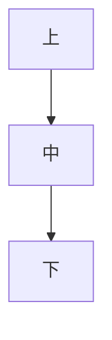
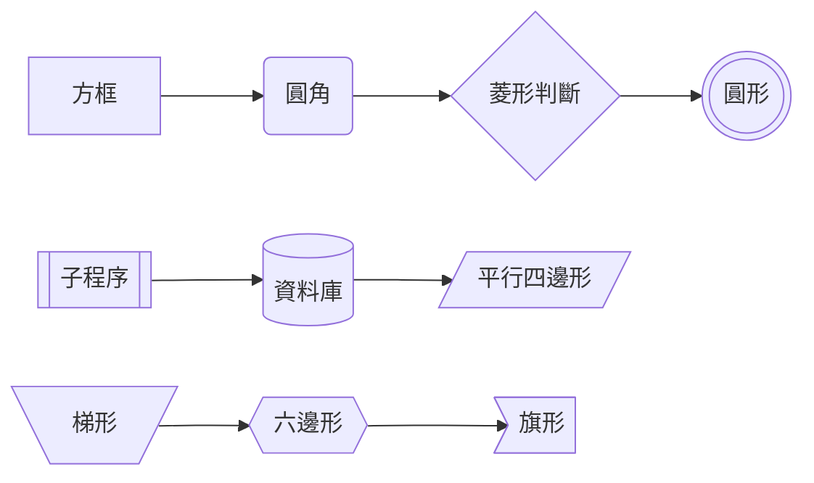
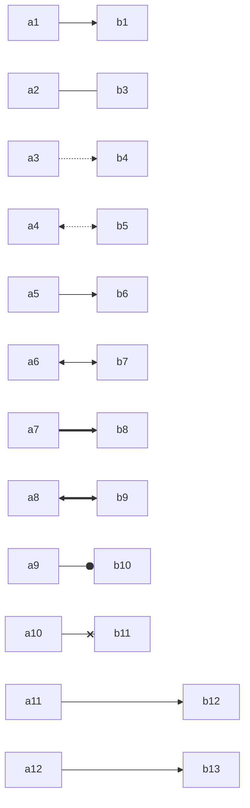
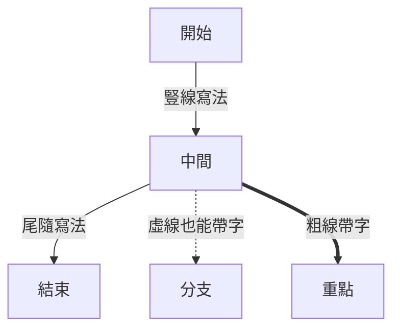
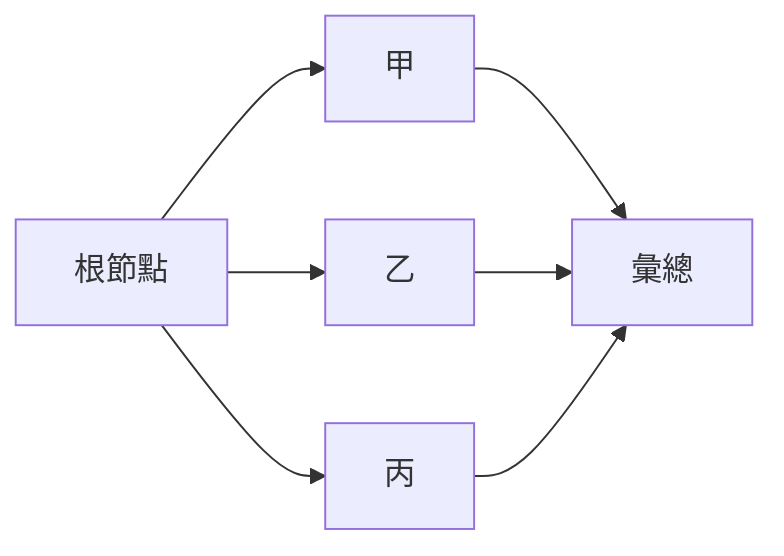

# Mermaid語法學習

> [!note]
>
> 本文所有示例都在Archive Markdown Editor內建的**Mermaid 10.9.8**上實測可渲染。想邊改邊看，請用菜單欄「工具 > Mermaid編輯器」。
>
> 每節的排版方式和「Markdown語法學習」一致：先給原始碼，再給渲染結果。

---

## 一、通用規則

#### 1. 第一行聲明圖的類型

Mermaid靠**第一行**判斷這是哪種圖，寫錯類型後面全都報錯。

````markdown

````


> [!caution]
>
> 聲明行必須**獨佔一行**，前後不能有空格以外的內容。圖內部的空行在部分圖類型裡會被當成結束，遇到莫名報錯時先刪掉空行試試。

#### 2. 註釋用`%%`

````markdown

````


> [!caution]
>
> `%%`註釋**必須獨佔一行**。把註釋寫在語句末尾（`A[甲] --> B[乙] %% 說明`）會直接報`Parse error`。

#### 3. 一條語句一行

Mermaid不像編程語言那樣支援續行。**一條語句寫一行**，不要試圖用逗號把多個節點擠在一行裡（除個別圖類型外）。

#### 4. 節點用「ID + 形狀」定義

ID是給連線用的短名字，方括號裡才是顯示出來的文字。ID只能包含字母、數字和`_`，**中文請放在形狀括號裡**，別當ID用。

````markdown

````


> [!tip]
>
> 文字裡出現`()`、`{}`、`[]`、`<>`、`#`這些和語法衝突的字符時，用引號把文字包起來：`A["特殊字符 (測試)"]`。

#### 5. 在Markdown裡怎麼寫

用帶`mermaid`語言標記的程式碼區塊，Archive Markdown Editor會自動把它渲染成圖：

`````markdown
````markdown

````
`````

````markdown

````

想顯示「圖的原始碼本身」而不是圖，就像上面那樣把` ```mermaid `再套一層程式碼區塊。

#### 6. 用`%%{init}%%`改主題和外觀

第一行之前可以放一條初始化指令，作用範圍是**當前這一張圖**：

````markdown

````


常用主題有`default`、`forest`、`dark`、`neutral`；`%%{init: {"themeVariables": {"primaryColor": "#ffe4c4"}}}%%`可以細調配色。

---

## 二、流程圖（flowchart）

流程圖是最常用的圖。`graph`是老寫法、`flowchart`是新寫法，**推薦用`flowchart`**，功能更全。

#### 7. 方向

````markdown

````

`TD`/`TB`上到下、`BT`下至上、`LR`左到右、`RL`右到左：


#### 8. 節點形狀

````markdown

````


形狀和括號對照：`[文字]`方框、`(文字)`圓角、`[[文字]]`子程序、`[(文字)]`資料庫、`((文字))`圓形、`(((文字)))`雙圓、`{文字}`菱形、`{{文字}}`六邊形、`[/文字/]`平行四邊形、`[\文字/]`梯形、`[/文字\]`倒梯形、`>文字]`旗形。

#### 9. 連線樣式

````markdown

````


`---`直線、`-->`箭頭、`<-->`雙向箭頭、`-.->`虛線箭頭、`<.->`雙向虛線、`==>`粗線、`<==>`雙向粗線、`--o`圓點端、`--x`叉形端、`x-->`/`o-->`反向端點。

> [!caution]
>
> 箭頭寫法有坑，以下在10.9.8裡**會報錯**，別照着老教程寫：`A <-- B`（雙向箭頭要寫成`<-->`）、`A <== B`（要寫成`<==>`）、`A o-- B`和`A x-- B`（端點符號必須緊貼箭頭尾部，寫成`--o`、`--x`，或者`o-->`、`x-->`）。


#### 10. 連線上的文字

兩種寫法：豎線夾着，或者把文字塞進箭頭的「缺口」裡（文字要放在收尾的箭頭符號**之前**）。

````markdown

````


#### 11. 一個節點連多條線

````markdown

````

```mermaid
flowchart LR
root[根節點] --> a[甲]
root --> b[乙]
root --> c[丙]
a & b & c --> merge[彙總]
```

`&`可以把多個節點併到一起，省掉重複書寫。

#### 12. 子圖`subgraph`

````markdown
```mermaid
flowchart TB
A[外部輸入] --> 內1
subgraph 前端組
direction LR
內1[頁面] --> 內2[狀態管理]
end
內2 --> B[後端]
subgraph 後端組
api[接口層] --> db[(資料庫)]
end
B --> api
```
````

```mermaid
flowchart TB
A[外部輸入] --> 內1
subgraph 前端組
direction LR
內1[頁面] --> 內2[狀態管理]
end
內2 --> B[後端]
subgraph 後端組
api[接口層] --> db[(資料庫)]
end
B --> api
```

`subgraph 名字`開頭、`end`結尾；子圖內部可以用`direction`單獨指定方向。子圖本身也能被連線引用（把`subgraph id [標題]`寫成帶ID的形式）。

#### 13. 上色與樣式

三種手段：`style`單點改、`classDef`+`class`批量改、`linkStyle`改連線。

````markdown
```mermaid
flowchart LR
A[普通] --> B[紅色警告]
B --> C[藍色重點]
A --> D[綠色通過]
classDef danger fill:#fee,stroke:#b91c1c,stroke-width:2px,color:#7f1d1d
classDef focus fill:#eff6ff,stroke:#1d4ed8,color:#1e3a8a
classDef pass fill:#f0fdf4,stroke:#15803d,color:#14532d
class B danger
class C focus
class D pass
style A fill:#fef3c7,stroke:#b45309
linkStyle 0 stroke:#b91c1c,stroke-width:3px
```
````

```mermaid
flowchart LR
A[普通] --> B[紅色警告]
B --> C[藍色重點]
A --> D[綠色通過]
classDef danger fill:#fee,stroke:#b91c1c,stroke-width:2px,color:#7f1d1d
classDef focus fill:#eff6ff,stroke:#1d4ed8,color:#1e3a8a
classDef pass fill:#f0fdf4,stroke:#15803d,color:#14532d
class B danger
class C focus
class D pass
style A fill:#fef3c7,stroke:#b45309
linkStyle 0 stroke:#b91c1c,stroke-width:3px
```

> [!note]
>
> `linkStyle`後面的數字是**連線的序號**，按圖中連線出現的順序從0開始數；寫`all`表示所有連線。也可以用`:::`簡寫：`B[紅色警告]:::danger`。

---

## 三、序列圖（sequenceDiagram）

#### 14. 參與者與消息

````markdown
```mermaid
sequenceDiagram
participant U as 使用者
participant W as 網頁
participant S as 伺服器
U->>W: 點擊登錄
W->>S: 提交賬號密碼
S-->>W: 返回令牌
W-->>U: 進入首頁
```
````

```mermaid
sequenceDiagram
participant U as 使用者
participant W as 網頁
participant S as 伺服器
U->>W: 點擊登錄
W->>S: 提交賬號密碼
S-->>W: 返回令牌
W-->>U: 進入首頁
```

`participant ID as 顯示名`聲明參與者並起別名（別名支援中文），參與者按聲明順序從左到右排列。

#### 15. 四種箭頭

| 寫法 | 含義 | 渲染 |
|:---|:---|:---|
| `A->>B` | 實心箭頭的同步調用 | 最常用 |
| `A-->>B` | 虛線返回 | 表示響應 |
| `A->B` | 細線實心箭頭 | 無特殊語義 |
| `A-->B` | 細線虛線箭頭 | 無特殊語義 |

#### 16. 激活條

````markdown
```mermaid
sequenceDiagram
participant C as 客戶端
participant S as 服務
C->>S: 請求資料
activate S
S-->>C: 響應
deactivate S
C->>+S: 簡寫：請求並激活
S-->>-C: 簡寫：響應並失活
```
````

```mermaid
sequenceDiagram
participant C as 客戶端
participant S as 服務
C->>S: 請求資料
activate S
S-->>C: 響應
deactivate S
C->>+S: 簡寫：請求並激活
S-->>-C: 簡寫：響應並失活
```

`activate`/`deactivate`畫出讓時序更清楚的豎直激活條，也可以直接在箭頭上用`+`/`-`簡寫。

#### 17. 備註

````markdown
```mermaid
sequenceDiagram
participant A as 甲
participant B as 乙
Note over A,B: 跨兩個參與者的備註
Note left of A: 左側備註
Note right of B: 右側備註
```
````

```mermaid
sequenceDiagram
participant A as 甲
participant B as 乙
Note over A,B: 跨兩個參與者的備註
Note left of A: 左側備註
Note right of B: 右側備註
```

#### 18. 循環與分支

````markdown
```mermaid
sequenceDiagram
participant U as 使用者
participant S as 服務
loop 每30秒心跳
U->>S: ping
S-->>U: pong
end
alt 令牌有效
S-->>U: 返回資料
else 令牌過期
S-->>U: 401未授權
U->>S: 刷新令牌
else 服務異常
S-->>U: 500
end
opt 開啓了除錯
S-->>U: 輸出除錯日誌
end
par 並行請求
S->>U: 推消息A
and
S->>U: 推消息B
end
```
````

```mermaid
sequenceDiagram
participant U as 使用者
participant S as 服務
loop 每30秒心跳
U->>S: ping
S-->>U: pong
end
alt 令牌有效
S-->>U: 返回資料
else 令牌過期
S-->>U: 401未授權
U->>S: 刷新令牌
else 服務異常
S-->>U: 500
end
opt 開啓了除錯
S-->>U: 輸出除錯日誌
end
par 並行請求
S->>U: 推消息A
and
S->>U: 推消息B
end
```

`loop 條件`、`alt`/`else`、`opt`、`par`/`and`都用`end`收尾。還有`critical 說明`配合`option`表示關鍵區段，`break 條件`表示中斷。

#### 19. 自動編號

在`sequenceDiagram`後面單獨加一行`autonumber`，消息會自動帶上序號：

```mermaid
sequenceDiagram
autonumber
participant A as 瀏覽器
participant B as 網關
A->>B: 建立連接
B-->>A: 握手完成
```

---

## 四、其他常用圖

#### 20. 類別圖（classDiagram）

````markdown
```mermaid
classDiagram
class Animal {
+String name
+int age
+makeSound() void
}
class Dog {
+bark() void
+fetch() void
}
class Bone {
+size int
}
Animal <|-- Dog
Dog --> "1..*" Bone : 喜歡
Dog o-- "1" Leash : 配有
class Dog {
<<可訓練>>
}
```
````

```mermaid
classDiagram
class Animal {
+String name
+int age
+makeSound() void
}
class Dog {
+bark() void
+fetch() void
}
class Bone {
+size int
}
Animal <|-- Dog
Dog --> "1..*" Bone : 喜歡
Dog o-- "1" Leash : 配有
class Dog {
<<可訓練>>
}
```

關係符號：`<|--`繼承、`*--`組合、`o--`聚合、`-->`關聯、`..>`依賴、`..|>`實現。成員前的可見性：`+`公開、`-`私有、`#`保護、`~`包級。`<<註釋>>`寫在類體第一行表示構造型。

#### 21. 狀態圖（stateDiagram-v2）

````markdown
```mermaid
stateDiagram-v2
[*] --> 草稿
草稿 --> 審覈中 : 提交
審覈中 --> 已通過 : 審覈通過
審覈中 --> 已駁回 : 資料不全
已通過 --> [*]
已駁回 --> 草稿 : 修改後重提
state 審覈中 {
[*] --> 形式審查
形式審查 --> 實質審查
實質審查 --> 複覈
}
```
````

```mermaid
stateDiagram-v2
[*] --> 草稿
草稿 --> 審覈中 : 提交
審覈中 --> 已通過 : 審覈通過
審覈中 --> 已駁回 : 資料不全
已通過 --> [*]
已駁回 --> 草稿 : 修改後重提
state 審覈中 {
[*] --> 形式審查
形式審查 --> 實質審查
實質審查 --> 複覈
}
```

`[*]`是初始/終止狀態，`state 名字 { ... }`表達複合狀態。還有`state if_name <<choice>>`（分支點）、`<<fork>>`/`<<join>>`（併發分合），以及`state 名字 : 描述文字`給狀態加副標題。

#### 22. ER圖（erDiagram）

````markdown
```mermaid
erDiagram
USER ||--o{ ORDER : "下單"
ORDER ||--|{ ORDER_ITEM : "包含"
PRODUCT ||--o{ ORDER_ITEM : "被購買"
USER {
string id "使用者編號"
string nickname "暱稱"
string email "郵箱"
}
ORDER {
string id "訂單號"
datetime created_at "創建時間"
int total "數量合計"
}
ORDER_ITEM {
string id "明細號"
int quantity "件數"
decimal price "單價"
}
```
````

```mermaid
erDiagram
USER ||--o{ ORDER : "下單"
ORDER ||--|{ ORDER_ITEM : "包含"
PRODUCT ||--o{ ORDER_ITEM : "被購買"
USER {
string id "使用者編號"
string nickname "暱稱"
string email "郵箱"
}
ORDER {
string id "訂單號"
datetime created_at "創建時間"
int total "數量合計"
}
ORDER_ITEM {
string id "明細號"
int quantity "件數"
decimal price "單價"
}
```

> [!caution]
>
> ER圖對中文限制最嚴：**實體名、屬性名、屬性類型只能是ASCII字母數字下劃線**，寫成`使用者 ||--o{ 訂單`會直接報錯。中文只能出現在兩個位置——關係標籤（必須加引號，如`: "下單"`）和屬性後面的註釋（也必須加引號，如`string id "使用者編號"`）。
>
> 實體名建議全大寫（`USER`、`ORDER_ITEM`），小寫在部分寫法下會報`Expecting 'ALPHANUM'...`。
>
> 基數符號讀法：`||`恰好一個、`|o`零或一個、`}o`零或多個、`|{`一或多個。左半段描述左邊實體、右半段描述右邊實體，如`USER ||--o{ ORDER`表示「一個使用者有零或多個訂單」。

#### 23. 甘特圖（gantt）

````markdown
```mermaid
gantt
title 項目排期
dateFormat YYYY-MM-DD
section 設計
需求評審 :done, d1, 2025-01-06, 3d
原型設計 :active, d2, after d1, 5d
section 開發
前端實現 :d3, after d2, 10d
後端實現 :d4, after d2, 12d
聯調測試 :crit, d5, after d4, 5d
```
````

```mermaid
gantt
title 項目排期
dateFormat YYYY-MM-DD
section 設計
需求評審 :done, d1, 2025-01-06, 3d
原型設計 :active, d2, after d1, 5d
section 開發
前端實現 :d3, after d2, 10d
後端實現 :d4, after d2, 12d
聯調測試 :crit, d5, after d4, 5d
```

任務行格式是`任務名 :狀態, ID, 開始時間, 時長`。狀態標記`done`已完成、`active`進行中、`crit`關鍵路徑；開始時間可以寫死日期，也可以用`after 別的任務ID`自動接續。`todayMarker off`可以隱藏「今天」那條豎線。

#### 24. 餅圖（pie）

````markdown
```mermaid
pie showData
title 瀏覽器市場份額
"Chrome" : 65.2
"Safari" : 18.8
"Edge" : 5.3
"其他" : 10.7
```
````

```mermaid
pie showData
title 瀏覽器市場份額
"Chrome" : 65.2
"Safari" : 18.8
"Edge" : 5.3
"其他" : 10.7
```

`showData`讓扇區上同時顯示數值。數值不需要加起來等於100。

#### 25. 時間線（timeline）

````markdown
```mermaid
timeline
title Archive Markdown Editor 大事記
2024 : 項目立項 : 確定mdz格式
2025 : 首個正式版 : 支援多媒體嵌入
2026 : 工具集 : LaTeX編輯器與Mermaid編輯器
```
````

```mermaid
timeline
title Archive Markdown Editor 大事記
2024 : 項目立項 : 確定mdz格式
2025 : 首個正式版 : 支援多媒體嵌入
2026 : 工具集 : LaTeX編輯器與Mermaid編輯器
```

`時間 : 事件A : 事件B`用冒號把同一時間點的多個事件排開，縮進表示層級。

#### 26. 使用者旅程圖（journey）

````markdown
```mermaid
journey
title 一鍵下單體驗
section 選購
開啟應用: 5: 顧客
搜索商品: 4: 顧客
section 下單
加入購物車: 3: 顧客
提交訂單: 2: 顧客, 系統
支付: 1: 顧客, 系統
```
````

```mermaid
journey
title 一鍵下單體驗
section 選購
開啟應用: 5: 顧客
搜索商品: 4: 顧客
section 下單
加入購物車: 3: 顧客
提交訂單: 2: 顧客, 系統
支付: 1: 顧客, 系統
```

> [!note]
>
> 聲明行的關鍵字是`journey`，不是`userJourney`（後者是Mermaid內部的模塊名，寫在圖裡會報`No diagram type detected`）。
>
> 任務行格式是`任務名: 評分: 參與者`，評分範圍1（很差）到5（很好），多個參與者用逗號分隔。

#### 27. 思維導圖（mindmap）

````markdown
```mermaid
mindmap
  root((項目計劃))
    研發
      前端
        介面
        交互
      後端
        接口
        存儲
    市場
      調研
      推廣
```
````

```mermaid
mindmap
  root((項目計劃))
    研發
      前端
        介面
        交互
      後端
        接口
        存儲
    市場
      調研
      推廣
```

> [!caution]
>
> mindmap**完全靠縮進表達層級**：縮進多少不重要，但同一層的縮進必須嚴格一致，且只能用空格（混進Tab就報錯）。中心節點寫作`root((文字))`，節點形狀同樣有`()`、`[]`、`{}`、`([])`等變體。

#### 28. 象限圖（quadrantChart）

````markdown
```mermaid
quadrantChart
title "功能優先級評估"
x-axis "實現成本低" --> "實現成本高"
y-axis "使用者價值低" --> "使用者價值高"
quadrant-1 "重點投入"
quadrant-2 "優先做"
quadrant-3 "順手做"
quadrant-4 "暫緩"
"LaTeX編輯器": [0.35, 0.8]
"Mermaid編輯器": [0.5, 0.75]
"匯出PDF": [0.7, 0.6]
"主題編輯器": [0.25, 0.2]
```
````

```mermaid
quadrantChart
title "功能優先級評估"
x-axis "實現成本低" --> "實現成本高"
y-axis "使用者價值低" --> "使用者價值高"
quadrant-1 "重點投入"
quadrant-2 "優先做"
quadrant-3 "順手做"
quadrant-4 "暫緩"
"LaTeX編輯器": [0.35, 0.8]
"Mermaid編輯器": [0.5, 0.75]
"匯出PDF": [0.7, 0.6]
"主題編輯器": [0.25, 0.2]
```

座標是`[x, y]`，取值0到1，四個象限從右上角開始逆時針編號1到4。

> [!caution]
>
> quadrantChart是**詞法分析最嚴**的圖類型：只要文字裡含空格或是中文，就必須整體加雙引號（軸標籤、象限名、資料點名字全都要）。漏引號會報`Lexical error ... Unrecognized text`。

#### 29. 需求圖（requirementDiagram）

````markdown
```mermaid
requirementDiagram

    requirement REQ_MDZ {
        id: "REQ-001"
        text: "支援mdz歸檔格式"
        risk: high
        verifymethod: test
    }

    functionalRequirement REQ_EXPORT {
        id: "REQ-002"
        text: "匯出離線HTML"
        risk: medium
        verifymethod: analysis
    }

    performanceRequirement REQ_SPEED {
        id: "REQ-003"
        text: "千行文檔渲染流暢"
        risk: low
        verifymethod: demonstration
    }

    REQ_MDZ - contains -> REQ_EXPORT
    REQ_EXPORT - satisfies -> REQ_SPEED
```
````

```mermaid
requirementDiagram

    requirement REQ_MDZ {
        id: "REQ-001"
        text: "支援mdz歸檔格式"
        risk: high
        verifymethod: test
    }

    functionalRequirement REQ_EXPORT {
        id: "REQ-002"
        text: "匯出離線HTML"
        risk: medium
        verifymethod: analysis
    }

    performanceRequirement REQ_SPEED {
        id: "REQ-003"
        text: "千行文檔渲染流暢"
        risk: low
        verifymethod: demonstration
    }

    REQ_MDZ - contains -> REQ_EXPORT
    REQ_EXPORT - satisfies -> REQ_SPEED
```

> [!caution]
>
> 這個圖類型語法極嚴，四點必須同時滿足：
>
> 1. 塊內屬性**必須縮進**（頂格寫`id:`就報錯）；
> 2. `text:`的值**必須加引號**；
> 3. 關係寫法是`A - 關係詞 -> B`，**不是**`A <- 關係詞 -> B`，也不是`A -[關係詞]-> B`；
> 4. `risk`只能填`lo`/`low`/`medium`/`high`，`verifymethod`只能填`analysis`/`inspection`/`demonstration`/`test`——填`performance`之類會報錯。
>
> 需求類型可用：`requirement`、`functionalRequirement`、`performanceRequirement`、`interfaceRequirement`、`physicalRequirement`、`designConstraint`。關係詞可用：`contains`、`derived`、`satisfies`、`verify`、`copies`。

#### 30. Git圖（gitGraph）

````markdown
```mermaid
gitGraph
commit
commit
branch develop
checkout develop
commit
commit
checkout main
merge develop
commit tag: "v1.0"
branch hotfix
checkout hotfix
commit
checkout main
merge hotfix
```
````

```mermaid
gitGraph
commit
commit
branch develop
checkout develop
commit
commit
checkout main
merge develop
commit tag: "v1.0"
branch hotfix
checkout hotfix
commit
checkout main
merge hotfix
```

`commit`、`branch 名字`、`checkout 名字`、`merge 名字`、`cherry-pick id: "..."`、`reset id: "..."`。預設分支名是`main`，可用`gitGraph: mainBranchName: "master"`改。

#### 31. XY座標圖（xychart-beta）

````markdown
```mermaid
xychart-beta
    title "月度活躍趨勢"
    x-axis ["一月", "二月", "三月", "四月", "五月"]
    y-axis "活躍使用者（千）" 0 --> 100
    bar [24, 45, 62, 58, 91]
    line [24, 45, 62, 58, 91]
```
````

```mermaid
xychart-beta
    title "月度活躍趨勢"
    x-axis ["一月", "二月", "三月", "四月", "五月"]
    y-axis "活躍使用者（千）" 0 --> 100
    bar [24, 45, 62, 58, 91]
    line [24, 45, 62, 58, 91]
```

> [!caution]
>
> `title`和`x-axis`的每一項都**必須加雙引號**：`x-axis [一月, 二月]`會報`Lexical error`，`x-axis ["一月", "二月"]`才可以通過。
>
> `bar`和`line`可以只寫一個，也可以疊加。帶`-beta`後綴說明它還在實驗階段，跨版本可能變動。

#### 32. 桑基圖（sankey-beta）

````markdown
```mermaid
sankey-beta
Entrance,Home,120
Entrance,Search,80
Home,Detail,70
Search,Detail,50
Detail,Order,45
Detail,Churn,75
```
````

```mermaid
sankey-beta
Entrance,Home,120
Entrance,Search,80
Home,Detail,70
Search,Detail,50
Detail,Order,45
Detail,Churn,75
```

每行是`源節點,目標節點,流量值`，第一行也可以寫成`source,target,value`表頭。

> [!caution]
>
> 桑基圖的節點名**只能是ASCII**，`流量入口,首頁,120`會直接報`Parse error`，加引號也救不回來。需要中文標籤時，請改用flowchart或桑基之外的圖。
>
> 同樣是`-beta`實驗特性。

#### 33. 塊圖（block-beta）

````markdown
```mermaid
block-beta
columns 3
in["輸入"] proc["解析"] out["輸出"]
db[("存儲")] space cache["緩存"]
in --> proc
proc --> out
proc --> db
db --> cache
cache --> out
```
````

```mermaid
block-beta
columns 3
in["輸入"] proc["解析"] out["輸出"]
db[("存儲")] space cache["緩存"]
in --> proc
proc --> out
proc --> db
db --> cache
cache --> out
```

`columns N`聲明每行幾個塊，`space`佔一格空白，`blockArrowShape: true`可把預設連線換成箭頭（需寫在`%%{init}%%`裡）。

---

## 五、在Archive Markdown Editor裡的限制

#### 34. 安全等級為strict

Archive Markdown Editor以`securityLevel: 'strict'`運行Mermaid，這是防止文檔裡的圖執行腳本的必要設置。代價是：

> [!caution]
>
> - 節點文字裡的**HTML標籤不會生效**：`A["<b>加粗</b>"]`會原樣顯示，不會變成粗體。
> - `click A "https://..."`這類給節點綁定鏈接、`click A callback()`這類綁定回調的寫法**被禁用**。
> - 需要強調請用第13節的`style`/`classDef`/`linkStyle`語法，而不是HTML標籤。

#### 35. 只認程式碼區塊，不認內聯

Mermaid只支援**圍欄程式碼區塊**（` ```mermaid `）這一種寫法，沒有行內圖。文檔裡想放多張圖就寫多個程式碼區塊，一張圖一個塊。

#### 36. 圖類型以10.9.8為準

你從網上看到的Mermaid教程大多基於11.x甚至更新版本，**新版本的圖類型在這裡畫不出來**。

| 本軟體（10.9.8）可用 | 更新版本才有的圖，本軟體**畫不出來** |
|:---|:---|
| flowchart/graph、sequenceDiagram、classDiagram、stateDiagram-v2、erDiagram、gantt、pie、journey、requirementDiagram、gitGraph、mindmap、timeline、quadrantChart、xychart-beta、block-beta、sankey-beta、C4系列 | architecture-beta、packet-beta、radar、ishikawa、kanban、treeView、venn |

> [!tip]
>
> 想知道某個圖類型在本軟體裡到底支不支援，最可靠的辦法是在「工具 > Mermaid編輯器」裡只寫聲明行試一下：能出圖就是支援，報`No diagram type detected matching given configuration`就是不支援。

#### 37. 常見報錯對照表

| 現象 | 原因 | 解決辦法 |
|:---|:---|:---|
| `Syntax error in text` | 當前程式碼區塊裡出現的內容被上一道工序（公式排版）改寫過，或者關鍵字拼錯 | 檢查聲明行拼寫；必要時重啓編輯頁 |
| `Parse error...Expecting 'ALPHANUM'` | ER圖實體名用了小寫或含中文 | ER圖實體名改成全大寫英文 |
| mindmap層級錯亂或直接報錯 | 縮進不一致，或混用了Tab和空格 | 統一用空格，同級縮進嚴格對齊 |
| 節點文字只顯示了一半 | 文字裡有`()[]{}`等語法字符 | 用引號包起來：`A["文字(含括號)"]` |
| 中文顯示成ID | 直接把中文寫成了節點ID | 中文放進形狀括號裡，ID用英文短名 |
| 圖完全空白 | 聲明行有多餘內容，或整塊縮進進了別的塊裡 | 聲明行獨佔一行、頂格寫 |
| 只有部分節點連線消失 | 連線的節點ID沒定義過或拼錯 | 檢查ID大小寫和拼寫 |
| 標籤裡的`<br>`換不了行 | strict安全等級禁用了HTML標籤 | 拆成兩個節點，或縮短文字 |
| 圖比預期醜、字號擠在一起 | 單張圖節點過多 | 拆成多張圖，或用`subgraph`分組 |

#### 38. 除錯建議

> [!tip]
>
> 1. **刪到能畫出來為止**。從只有聲明行加兩個節點開始，一行一行加，出錯的那一行就是元兇。
> 2. **善用「工具 > Mermaid編輯器」**。它左側改右側立刻重渲染，比在文檔裡來回切換快得多，而且解析失敗時會在預覽區顯示錯誤資訊。
> 3. **報錯資訊裡的行列號很有用**。Mermaid的`Parse error`會指出它期望看到什麼符號、在哪一行，直接定位過去。
> 4. **拿不準圖類型支不支援，就先畫最小例子**：聲明行 + 一條關係。能出圖就說明類型名寫對了。

---

## 六、延伸閱讀

- [Mermaid官方文檔](https://mermaid.js.org/)（注意切換到與你本地版本匹配的10.9文檔頁，別照抄11.x的新語法）
- [Mermaid官方在線編輯器](https://mermaid.live/)（可以先在網頁上調通，再粘迴文檔裡）
- 本軟體內建的另外兩篇文檔：「幫助 > Markdown語法學習」和「幫助 > LaTeX語法學習」
