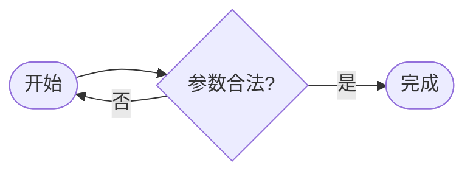
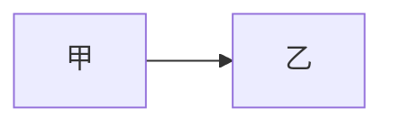
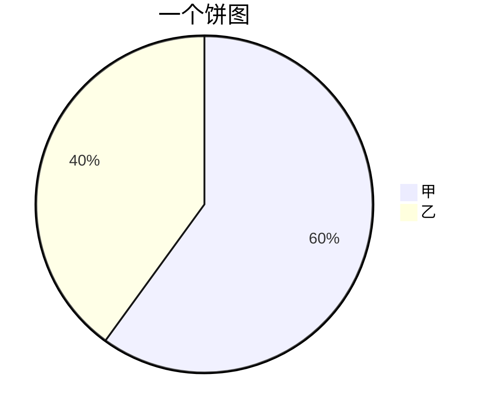
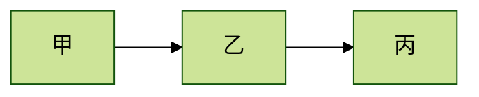
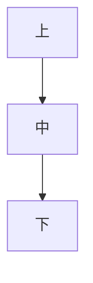
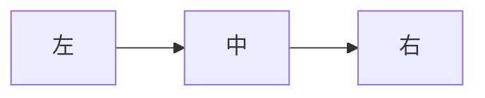
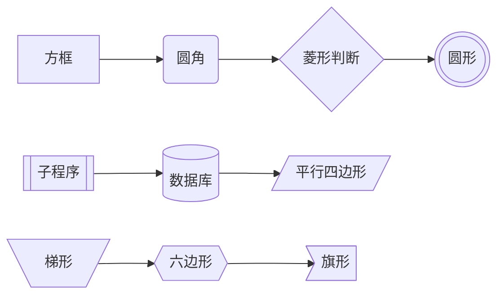
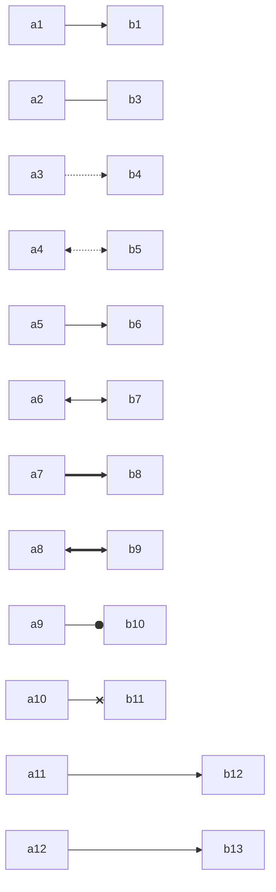
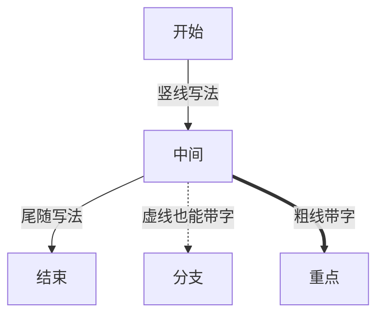
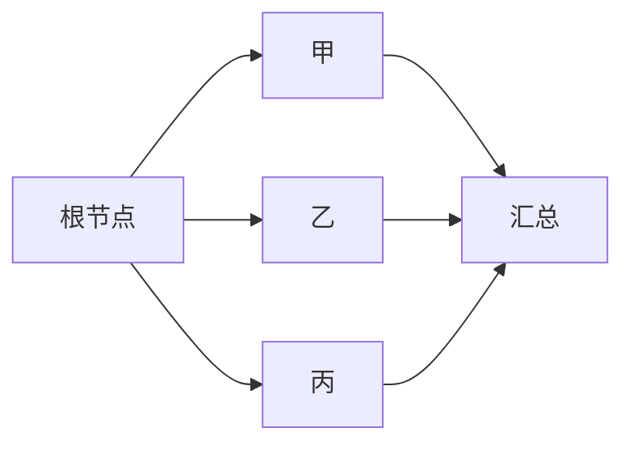

# Mermaid语法学习

> [!note]
>
> 本文所有示例都在Archive Markdown Editor内置的**Mermaid 10.9.8**上实测可渲染。想边改边看，请用菜单栏「工具 > Mermaid编辑器」。
>
> 每节的排版方式和「Markdown语法学习」一致：先给源码，再给渲染结果。

---

## 一、通用规则

#### 1. 第一行声明图的类型

Mermaid靠**第一行**判断这是哪种图，写错类型后面全都报错。

````markdown

````


> [!caution]
>
> 声明行必须**独占一行**，前后不能有空格以外的内容。图内部的空行在部分图类型里会被当成结束，遇到莫名报错时先删掉空行试试。

#### 2. 注释用`%%`

````markdown

````


> [!caution]
>
> `%%`注释**必须独占一行**。把注释写在语句末尾（`A[甲] --> B[乙] %% 说明`）会直接报`Parse error`。

#### 3. 一条语句一行

Mermaid不像编程语言那样支持续行。**一条语句写一行**，不要试图用逗号把多个节点挤在一行里（除个别图类型外）。

#### 4. 节点用“ID + 形状”定义

ID是给连线用的短名字，方括号里才是显示出来的文字。ID只能包含字母、数字和`_`，**中文请放在形状括号里**，别当ID用。

````markdown

````


> [!tip]
>
> 文字里出现`()`、`{}`、`[]`、`<>`、`#`这些和语法冲突的字符时，用引号把文字包起来：`A["特殊字符 (测试)"]`。

#### 5. 在Markdown里怎么写

用带`mermaid`语言标记的代码块，Archive Markdown Editor会自动把它渲染成图：

`````markdown
````markdown

````
`````

````markdown

````

想显示“图的源码本身”而不是图，就像上面那样把` ```mermaid `再套一层代码块。

#### 6. 用`%%{init}%%`改主题和外观

第一行之前可以放一条初始化指令，作用范围是**当前这一张图**：

````markdown

````


常用主题有`default`、`forest`、`dark`、`neutral`；`%%{init: {"themeVariables": {"primaryColor": "#ffe4c4"}}}%%`可以细调配色。

---

## 二、流程图（flowchart）

流程图是最常用的图。`graph`是老写法、`flowchart`是新写法，**推荐用`flowchart`**，功能更全。

#### 7. 方向

````markdown

````

`TD`/`TB`上到下、`BT`下至上、`LR`左到右、`RL`右到左：




#### 8. 节点形状

````markdown

````


形状和括号对照：`[文字]`方框、`(文字)`圆角、`[[文字]]`子程序、`[(文字)]`数据库、`((文字))`圆形、`(((文字)))`双圆、`{文字}`菱形、`{{文字}}`六边形、`[/文字/]`平行四边形、`[\文字/]`梯形、`[/文字\]`倒梯形、`>文字]`旗形。

#### 9. 连线样式

````markdown

````


`---`直线、`-->`箭头、`<-->`双向箭头、`-.->`虚线箭头、`<.->`双向虚线、`==>`粗线、`<==>`双向粗线、`--o`圆点端、`--x`叉形端、`x-->`/`o-->`反向端点。

> [!caution]
>
> 箭头写法有坑，以下在10.9.8里**会报错**，别照着老教程写：`A <-- B`（双向箭头要写成`<-->`）、`A <== B`（要写成`<==>`）、`A o-- B`和`A x-- B`（端点符号必须紧贴箭头尾部，写成`--o`、`--x`，或者`o-->`、`x-->`）。


#### 10. 连线上的文字

两种写法：竖线夹着，或者把文字塞进箭头的“缺口”里（文字要放在收尾的箭头符号**之前**）。

````markdown

````


#### 11. 一个节点连多条线

````markdown

````

```mermaid
flowchart LR
root[根节点] --> a[甲]
root --> b[乙]
root --> c[丙]
a & b & c --> merge[汇总]
```

`&`可以把多个节点并到一起，省掉重复书写。

#### 12. 子图`subgraph`

````markdown
```mermaid
flowchart TB
A[外部输入] --> 内1
subgraph 前端组
direction LR
内1[页面] --> 内2[状态管理]
end
内2 --> B[后端]
subgraph 后端组
api[接口层] --> db[(数据库)]
end
B --> api
```
````

```mermaid
flowchart TB
A[外部输入] --> 内1
subgraph 前端组
direction LR
内1[页面] --> 内2[状态管理]
end
内2 --> B[后端]
subgraph 后端组
api[接口层] --> db[(数据库)]
end
B --> api
```

`subgraph 名字`开头、`end`结尾；子图内部可以用`direction`单独指定方向。子图本身也能被连线引用（把`subgraph id [标题]`写成带ID的形式）。

#### 13. 上色与样式

三种手段：`style`单点改、`classDef`+`class`批量改、`linkStyle`改连线。

````markdown
```mermaid
flowchart LR
A[普通] --> B[红色警告]
B --> C[蓝色重点]
A --> D[绿色通过]
classDef danger fill:#fee,stroke:#b91c1c,stroke-width:2px,color:#7f1d1d
classDef focus fill:#eff6ff,stroke:#1d4ed8,color:#1e3a8a
classDef pass fill:#f0fdf4,stroke:#15803d,color:#14532d
class B danger
class C focus
class D pass
style A fill:#fef3c7,stroke:#b45309
linkStyle 0 stroke:#b91c1c,stroke-width:3px
```
````

```mermaid
flowchart LR
A[普通] --> B[红色警告]
B --> C[蓝色重点]
A --> D[绿色通过]
classDef danger fill:#fee,stroke:#b91c1c,stroke-width:2px,color:#7f1d1d
classDef focus fill:#eff6ff,stroke:#1d4ed8,color:#1e3a8a
classDef pass fill:#f0fdf4,stroke:#15803d,color:#14532d
class B danger
class C focus
class D pass
style A fill:#fef3c7,stroke:#b45309
linkStyle 0 stroke:#b91c1c,stroke-width:3px
```

> [!note]
>
> `linkStyle`后面的数字是**连线的序号**，按图中连线出现的顺序从0开始数；写`all`表示所有连线。也可以用`:::`简写：`B[红色警告]:::danger`。

---

## 三、序列图（sequenceDiagram）

#### 14. 参与者与消息

````markdown
```mermaid
sequenceDiagram
participant U as 用户
participant W as 网页
participant S as 服务器
U->>W: 点击登录
W->>S: 提交账号密码
S-->>W: 返回令牌
W-->>U: 进入首页
```
````

```mermaid
sequenceDiagram
participant U as 用户
participant W as 网页
participant S as 服务器
U->>W: 点击登录
W->>S: 提交账号密码
S-->>W: 返回令牌
W-->>U: 进入首页
```

`participant ID as 显示名`声明参与者并起别名（别名支持中文），参与者按声明顺序从左到右排列。

#### 15. 四种箭头

| 写法 | 含义 | 渲染 |
|:---|:---|:---|
| `A->>B` | 实心箭头的同步调用 | 最常用 |
| `A-->>B` | 虚线返回 | 表示响应 |
| `A->B` | 细线实心箭头 | 无特殊语义 |
| `A-->B` | 细线虚线箭头 | 无特殊语义 |

#### 16. 激活条

````markdown
```mermaid
sequenceDiagram
participant C as 客户端
participant S as 服务
C->>S: 请求数据
activate S
S-->>C: 响应
deactivate S
C->>+S: 简写：请求并激活
S-->>-C: 简写：响应并失活
```
````

```mermaid
sequenceDiagram
participant C as 客户端
participant S as 服务
C->>S: 请求数据
activate S
S-->>C: 响应
deactivate S
C->>+S: 简写：请求并激活
S-->>-C: 简写：响应并失活
```

`activate`/`deactivate`画出让时序更清楚的竖直激活条，也可以直接在箭头上用`+`/`-`简写。

#### 17. 备注

````markdown
```mermaid
sequenceDiagram
participant A as 甲
participant B as 乙
Note over A,B: 跨两个参与者的备注
Note left of A: 左侧备注
Note right of B: 右侧备注
```
````

```mermaid
sequenceDiagram
participant A as 甲
participant B as 乙
Note over A,B: 跨两个参与者的备注
Note left of A: 左侧备注
Note right of B: 右侧备注
```

#### 18. 循环与分支

````markdown
```mermaid
sequenceDiagram
participant U as 用户
participant S as 服务
loop 每30秒心跳
U->>S: ping
S-->>U: pong
end
alt 令牌有效
S-->>U: 返回数据
else 令牌过期
S-->>U: 401未授权
U->>S: 刷新令牌
else 服务异常
S-->>U: 500
end
opt 开启了调试
S-->>U: 输出调试日志
end
par 并行请求
S->>U: 推消息A
and
S->>U: 推消息B
end
```
````

```mermaid
sequenceDiagram
participant U as 用户
participant S as 服务
loop 每30秒心跳
U->>S: ping
S-->>U: pong
end
alt 令牌有效
S-->>U: 返回数据
else 令牌过期
S-->>U: 401未授权
U->>S: 刷新令牌
else 服务异常
S-->>U: 500
end
opt 开启了调试
S-->>U: 输出调试日志
end
par 并行请求
S->>U: 推消息A
and
S->>U: 推消息B
end
```

`loop 条件`、`alt`/`else`、`opt`、`par`/`and`都用`end`收尾。还有`critical 说明`配合`option`表示关键区段，`break 条件`表示中断。

#### 19. 自动编号

在`sequenceDiagram`后面单独加一行`autonumber`，消息会自动带上序号：

```mermaid
sequenceDiagram
autonumber
participant A as 浏览器
participant B as 网关
A->>B: 建立连接
B-->>A: 握手完成
```

---

## 四、其他常用图

#### 20. 类图（classDiagram）

````markdown
```mermaid
classDiagram
class Animal {
+String name
+int age
+makeSound() void
}
class Dog {
+bark() void
+fetch() void
}
class Bone {
+size int
}
Animal <|-- Dog
Dog --> "1..*" Bone : 喜欢
Dog o-- "1" Leash : 配有
class Dog {
<<可训练>>
}
```
````

```mermaid
classDiagram
class Animal {
+String name
+int age
+makeSound() void
}
class Dog {
+bark() void
+fetch() void
}
class Bone {
+size int
}
Animal <|-- Dog
Dog --> "1..*" Bone : 喜欢
Dog o-- "1" Leash : 配有
class Dog {
<<可训练>>
}
```

关系符号：`<|--`继承、`*--`组合、`o--`聚合、`-->`关联、`..>`依赖、`..|>`实现。成员前的可见性：`+`公开、`-`私有、`#`保护、`~`包级。`<<注释>>`写在类体第一行表示构造型。

#### 21. 状态图（stateDiagram-v2）

````markdown
```mermaid
stateDiagram-v2
[*] --> 草稿
草稿 --> 审核中 : 提交
审核中 --> 已通过 : 审核通过
审核中 --> 已驳回 : 资料不全
已通过 --> [*]
已驳回 --> 草稿 : 修改后重提
state 审核中 {
[*] --> 形式审查
形式审查 --> 实质审查
实质审查 --> 复核
}
```
````

```mermaid
stateDiagram-v2
[*] --> 草稿
草稿 --> 审核中 : 提交
审核中 --> 已通过 : 审核通过
审核中 --> 已驳回 : 资料不全
已通过 --> [*]
已驳回 --> 草稿 : 修改后重提
state 审核中 {
[*] --> 形式审查
形式审查 --> 实质审查
实质审查 --> 复核
}
```

`[*]`是初始/终止状态，`state 名字 { ... }`表达复合状态。还有`state if_name <<choice>>`（分支点）、`<<fork>>`/`<<join>>`（并发分合），以及`state 名字 : 描述文字`给状态加副标题。

#### 22. ER图（erDiagram）

````markdown
```mermaid
erDiagram
USER ||--o{ ORDER : "下单"
ORDER ||--|{ ORDER_ITEM : "包含"
PRODUCT ||--o{ ORDER_ITEM : "被购买"
USER {
string id "用户编号"
string nickname "昵称"
string email "邮箱"
}
ORDER {
string id "订单号"
datetime created_at "创建时间"
int total "数量合计"
}
ORDER_ITEM {
string id "明细号"
int quantity "件数"
decimal price "单价"
}
```
````

```mermaid
erDiagram
USER ||--o{ ORDER : "下单"
ORDER ||--|{ ORDER_ITEM : "包含"
PRODUCT ||--o{ ORDER_ITEM : "被购买"
USER {
string id "用户编号"
string nickname "昵称"
string email "邮箱"
}
ORDER {
string id "订单号"
datetime created_at "创建时间"
int total "数量合计"
}
ORDER_ITEM {
string id "明细号"
int quantity "件数"
decimal price "单价"
}
```

> [!caution]
>
> ER图对中文限制最严：**实体名、属性名、属性类型只能是ASCII字母数字下划线**，写成`用户 ||--o{ 订单`会直接报错。中文只能出现在两个位置——关系标签（必须加引号，如`: "下单"`）和属性后面的注释（也必须加引号，如`string id "用户编号"`）。
>
> 实体名建议全大写（`USER`、`ORDER_ITEM`），小写在部分写法下会报`Expecting 'ALPHANUM'...`。
>
> 基数符号读法：`||`恰好一个、`|o`零或一个、`}o`零或多个、`|{`一或多个。左半段描述左边实体、右半段描述右边实体，如`USER ||--o{ ORDER`表示“一个用户有零或多个订单”。

#### 23. 甘特图（gantt）

````markdown
```mermaid
gantt
title 项目排期
dateFormat YYYY-MM-DD
section 设计
需求评审 :done, d1, 2025-01-06, 3d
原型设计 :active, d2, after d1, 5d
section 开发
前端实现 :d3, after d2, 10d
后端实现 :d4, after d2, 12d
联调测试 :crit, d5, after d4, 5d
```
````

```mermaid
gantt
title 项目排期
dateFormat YYYY-MM-DD
section 设计
需求评审 :done, d1, 2025-01-06, 3d
原型设计 :active, d2, after d1, 5d
section 开发
前端实现 :d3, after d2, 10d
后端实现 :d4, after d2, 12d
联调测试 :crit, d5, after d4, 5d
```

任务行格式是`任务名 :状态, ID, 开始时间, 时长`。状态标记`done`已完成、`active`进行中、`crit`关键路径；开始时间可以写死日期，也可以用`after 别的任务ID`自动接续。`todayMarker off`可以隐藏“今天”那条竖线。

#### 24. 饼图（pie）

````markdown
```mermaid
pie showData
title 浏览器市场份额
"Chrome" : 65.2
"Safari" : 18.8
"Edge" : 5.3
"其他" : 10.7
```
````

```mermaid
pie showData
title 浏览器市场份额
"Chrome" : 65.2
"Safari" : 18.8
"Edge" : 5.3
"其他" : 10.7
```

`showData`让扇区上同时显示数值。数值不需要加起来等于100。

#### 25. 时间线（timeline）

````markdown
```mermaid
timeline
title Archive Markdown Editor 大事记
2024 : 项目立项 : 确定mdz格式
2025 : 首个正式版 : 支持多媒体嵌入
2026 : 工具集 : LaTeX编辑器与Mermaid编辑器
```
````

```mermaid
timeline
title Archive Markdown Editor 大事记
2024 : 项目立项 : 确定mdz格式
2025 : 首个正式版 : 支持多媒体嵌入
2026 : 工具集 : LaTeX编辑器与Mermaid编辑器
```

`时间 : 事件A : 事件B`用冒号把同一时间点的多个事件排开，缩进表示层级。

#### 26. 用户旅程图（journey）

````markdown
```mermaid
journey
title 一键下单体验
section 选购
打开应用: 5: 顾客
搜索商品: 4: 顾客
section 下单
加入购物车: 3: 顾客
提交订单: 2: 顾客, 系统
支付: 1: 顾客, 系统
```
````

```mermaid
journey
title 一键下单体验
section 选购
打开应用: 5: 顾客
搜索商品: 4: 顾客
section 下单
加入购物车: 3: 顾客
提交订单: 2: 顾客, 系统
支付: 1: 顾客, 系统
```

> [!note]
>
> 声明行的关键字是`journey`，不是`userJourney`（后者是Mermaid内部的模块名，写在图里会报`No diagram type detected`）。
>
> 任务行格式是`任务名: 评分: 参与者`，评分范围1（很差）到5（很好），多个参与者用逗号分隔。

#### 27. 思维导图（mindmap）

````markdown
```mermaid
mindmap
  root((项目计划))
    研发
      前端
        界面
        交互
      后端
        接口
        存储
    市场
      调研
      推广
```
````

```mermaid
mindmap
  root((项目计划))
    研发
      前端
        界面
        交互
      后端
        接口
        存储
    市场
      调研
      推广
```

> [!caution]
>
> mindmap**完全靠缩进表达层级**：缩进多少不重要，但同一层的缩进必须严格一致，且只能用空格（混进Tab就报错）。中心节点写作`root((文字))`，节点形状同样有`()`、`[]`、`{}`、`([])`等变体。

#### 28. 象限图（quadrantChart）

````markdown
```mermaid
quadrantChart
title "功能优先级评估"
x-axis "实现成本低" --> "实现成本高"
y-axis "用户价值低" --> "用户价值高"
quadrant-1 "重点投入"
quadrant-2 "优先做"
quadrant-3 "顺手做"
quadrant-4 "暂缓"
"LaTeX编辑器": [0.35, 0.8]
"Mermaid编辑器": [0.5, 0.75]
"导出PDF": [0.7, 0.6]
"主题编辑器": [0.25, 0.2]
```
````

```mermaid
quadrantChart
title "功能优先级评估"
x-axis "实现成本低" --> "实现成本高"
y-axis "用户价值低" --> "用户价值高"
quadrant-1 "重点投入"
quadrant-2 "优先做"
quadrant-3 "顺手做"
quadrant-4 "暂缓"
"LaTeX编辑器": [0.35, 0.8]
"Mermaid编辑器": [0.5, 0.75]
"导出PDF": [0.7, 0.6]
"主题编辑器": [0.25, 0.2]
```

坐标是`[x, y]`，取值0到1，四个象限从右上角开始逆时针编号1到4。

> [!caution]
>
> quadrantChart是**词法分析最严**的图类型：只要文字里含空格或是中文，就必须整体加双引号（轴标签、象限名、数据点名字全都要）。漏引号会报`Lexical error ... Unrecognized text`。

#### 29. 需求图（requirementDiagram）

````markdown
```mermaid
requirementDiagram

    requirement REQ_MDZ {
        id: "REQ-001"
        text: "支持mdz归档格式"
        risk: high
        verifymethod: test
    }

    functionalRequirement REQ_EXPORT {
        id: "REQ-002"
        text: "导出离线HTML"
        risk: medium
        verifymethod: analysis
    }

    performanceRequirement REQ_SPEED {
        id: "REQ-003"
        text: "千行文档渲染流畅"
        risk: low
        verifymethod: demonstration
    }

    REQ_MDZ - contains -> REQ_EXPORT
    REQ_EXPORT - satisfies -> REQ_SPEED
```
````

```mermaid
requirementDiagram

    requirement REQ_MDZ {
        id: "REQ-001"
        text: "支持mdz归档格式"
        risk: high
        verifymethod: test
    }

    functionalRequirement REQ_EXPORT {
        id: "REQ-002"
        text: "导出离线HTML"
        risk: medium
        verifymethod: analysis
    }

    performanceRequirement REQ_SPEED {
        id: "REQ-003"
        text: "千行文档渲染流畅"
        risk: low
        verifymethod: demonstration
    }

    REQ_MDZ - contains -> REQ_EXPORT
    REQ_EXPORT - satisfies -> REQ_SPEED
```

> [!caution]
>
> 这个图类型语法极严，四点必须同时满足：
>
> 1. 块内属性**必须缩进**（顶格写`id:`就报错）；
> 2. `text:`的值**必须加引号**；
> 3. 关系写法是`A - 关系词 -> B`，**不是**`A <- 关系词 -> B`，也不是`A -[关系词]-> B`；
> 4. `risk`只能填`lo`/`low`/`medium`/`high`，`verifymethod`只能填`analysis`/`inspection`/`demonstration`/`test`——填`performance`之类会报错。
>
> 需求类型可用：`requirement`、`functionalRequirement`、`performanceRequirement`、`interfaceRequirement`、`physicalRequirement`、`designConstraint`。关系词可用：`contains`、`derived`、`satisfies`、`verify`、`copies`。

#### 30. Git图（gitGraph）

````markdown
```mermaid
gitGraph
commit
commit
branch develop
checkout develop
commit
commit
checkout main
merge develop
commit tag: "v1.0"
branch hotfix
checkout hotfix
commit
checkout main
merge hotfix
```
````

```mermaid
gitGraph
commit
commit
branch develop
checkout develop
commit
commit
checkout main
merge develop
commit tag: "v1.0"
branch hotfix
checkout hotfix
commit
checkout main
merge hotfix
```

`commit`、`branch 名字`、`checkout 名字`、`merge 名字`、`cherry-pick id: "..."`、`reset id: "..."`。默认分支名是`main`，可用`gitGraph: mainBranchName: "master"`改。

#### 31. XY坐标图（xychart-beta）

````markdown
```mermaid
xychart-beta
    title "月度活跃趋势"
    x-axis ["一月", "二月", "三月", "四月", "五月"]
    y-axis "活跃用户（千）" 0 --> 100
    bar [24, 45, 62, 58, 91]
    line [24, 45, 62, 58, 91]
```
````

```mermaid
xychart-beta
    title "月度活跃趋势"
    x-axis ["一月", "二月", "三月", "四月", "五月"]
    y-axis "活跃用户（千）" 0 --> 100
    bar [24, 45, 62, 58, 91]
    line [24, 45, 62, 58, 91]
```

> [!caution]
>
> `title`和`x-axis`的每一项都**必须加双引号**：`x-axis [一月, 二月]`会报`Lexical error`，`x-axis ["一月", "二月"]`才可以通过。
>
> `bar`和`line`可以只写一个，也可以叠加。带`-beta`后缀说明它还在实验阶段，跨版本可能变动。

#### 32. 桑基图（sankey-beta）

````markdown
```mermaid
sankey-beta
Entrance,Home,120
Entrance,Search,80
Home,Detail,70
Search,Detail,50
Detail,Order,45
Detail,Churn,75
```
````

```mermaid
sankey-beta
Entrance,Home,120
Entrance,Search,80
Home,Detail,70
Search,Detail,50
Detail,Order,45
Detail,Churn,75
```

每行是`源节点,目标节点,流量值`，第一行也可以写成`source,target,value`表头。

> [!caution]
>
> 桑基图的节点名**只能是ASCII**，`流量入口,首页,120`会直接报`Parse error`，加引号也救不回来。需要中文标签时，请改用flowchart或桑基之外的图。
>
> 同样是`-beta`实验特性。

#### 33. 块图（block-beta）

````markdown
```mermaid
block-beta
columns 3
in["输入"] proc["解析"] out["输出"]
db[("存储")] space cache["缓存"]
in --> proc
proc --> out
proc --> db
db --> cache
cache --> out
```
````

```mermaid
block-beta
columns 3
in["输入"] proc["解析"] out["输出"]
db[("存储")] space cache["缓存"]
in --> proc
proc --> out
proc --> db
db --> cache
cache --> out
```

`columns N`声明每行几个块，`space`占一格空白，`blockArrowShape: true`可把默认连线换成箭头（需写在`%%{init}%%`里）。

---

## 五、在Archive Markdown Editor里的限制

#### 34. 安全等级为strict

Archive Markdown Editor以`securityLevel: 'strict'`运行Mermaid，这是防止文档里的图执行脚本的必要设置。代价是：

> [!caution]
>
> - 节点文字里的**HTML标签不会生效**：`A["<b>加粗</b>"]`会原样显示，不会变成粗体。
> - `click A "https://..."`这类给节点绑定链接、`click A callback()`这类绑定回调的写法**被禁用**。
> - 需要强调请用第13节的`style`/`classDef`/`linkStyle`语法，而不是HTML标签。

#### 35. 只认代码块，不认内联

Mermaid只支持**围栏代码块**（` ```mermaid `）这一种写法，没有行内图。文档里想放多张图就写多个代码块，一张图一个块。

#### 36. 图类型以10.9.8为准

你从网上看到的Mermaid教程大多基于11.x甚至更新版本，**新版本的图类型在这里画不出来**。

| 本软件（10.9.8）可用 | 更新版本才有的图，本软件**画不出来** |
|:---|:---|
| flowchart/graph、sequenceDiagram、classDiagram、stateDiagram-v2、erDiagram、gantt、pie、journey、requirementDiagram、gitGraph、mindmap、timeline、quadrantChart、xychart-beta、block-beta、sankey-beta、C4系列 | architecture-beta、packet-beta、radar、ishikawa、kanban、treeView、venn |

> [!tip]
>
> 想知道某个图类型在本软件里到底支不支持，最可靠的办法是在「工具 > Mermaid编辑器」里只写声明行试一下：能出图就是支持，报`No diagram type detected matching given configuration`就是不支持。

#### 37. 常见报错对照表

| 现象 | 原因 | 解决办法 |
|:---|:---|:---|
| `Syntax error in text` | 当前代码块里出现的内容被上一道工序（公式排版）改写过，或者关键字拼错 | 检查声明行拼写；必要时重启编辑页 |
| `Parse error...Expecting 'ALPHANUM'` | ER图实体名用了小写或含中文 | ER图实体名改成全大写英文 |
| mindmap层级错乱或直接报错 | 缩进不一致，或混用了Tab和空格 | 统一用空格，同级缩进严格对齐 |
| 节点文字只显示了一半 | 文字里有`()[]{}`等语法字符 | 用引号包起来：`A["文字(含括号)"]` |
| 中文显示成ID | 直接把中文写成了节点ID | 中文放进形状括号里，ID用英文短名 |
| 图完全空白 | 声明行有多余内容，或整块缩进进了别的块里 | 声明行独占一行、顶格写 |
| 只有部分节点连线消失 | 连线的节点ID没定义过或拼错 | 检查ID大小写和拼写 |
| 标签里的`<br>`换不了行 | strict安全等级禁用了HTML标签 | 拆成两个节点，或缩短文字 |
| 图比预期丑、字号挤在一起 | 单张图节点过多 | 拆成多张图，或用`subgraph`分组 |

#### 38. 调试建议

> [!tip]
>
> 1. **删到能画出来为止**。从只有声明行加两个节点开始，一行一行加，出错的那一行就是元凶。
> 2. **善用「工具 > Mermaid编辑器」**。它左侧改右侧立刻重渲染，比在文档里来回切换快得多，而且解析失败时会在预览区显示错误信息。
> 3. **报错信息里的行列号很有用**。Mermaid的`Parse error`会指出它期望看到什么符号、在哪一行，直接定位过去。
> 4. **拿不准图类型支不支持，就先画最小例子**：声明行 + 一条关系。能出图就说明类型名写对了。

---

## 六、延伸阅读

- [Mermaid官方文档](https://mermaid.js.org/)（注意切换到与你本地版本匹配的10.9文档页，别照抄11.x的新语法）
- [Mermaid官方在线编辑器](https://mermaid.live/)（可以先在网页上调通，再粘回文档里）
- 本软件内置的另外两篇文档：「帮助 > Markdown语法学习」和「帮助 > LaTeX语法学习」
